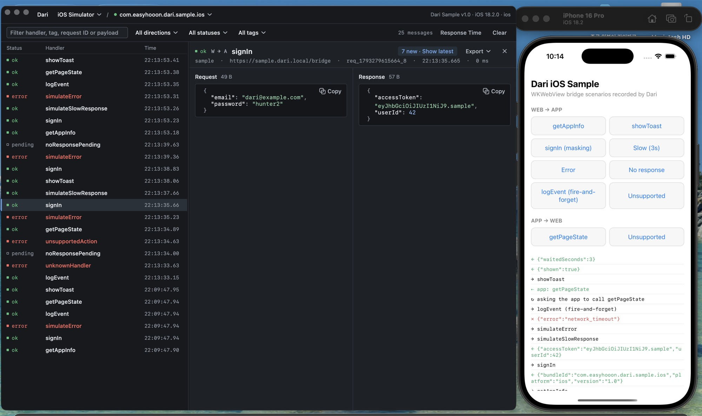
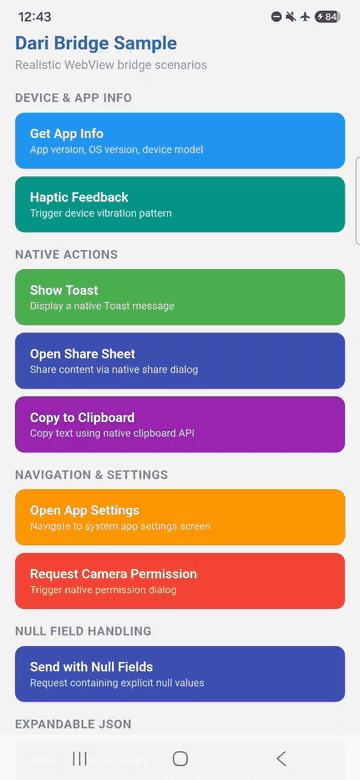
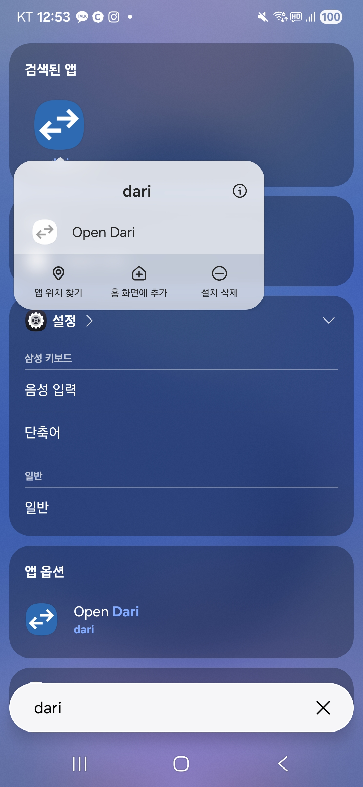
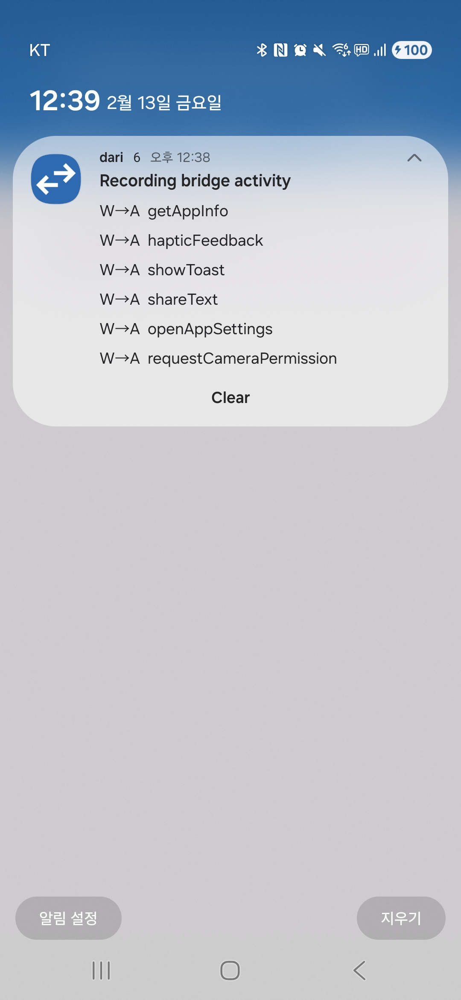
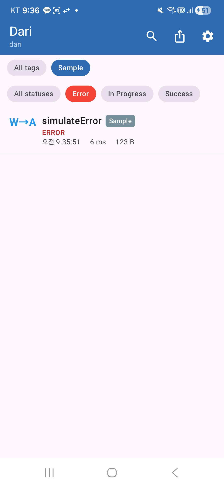
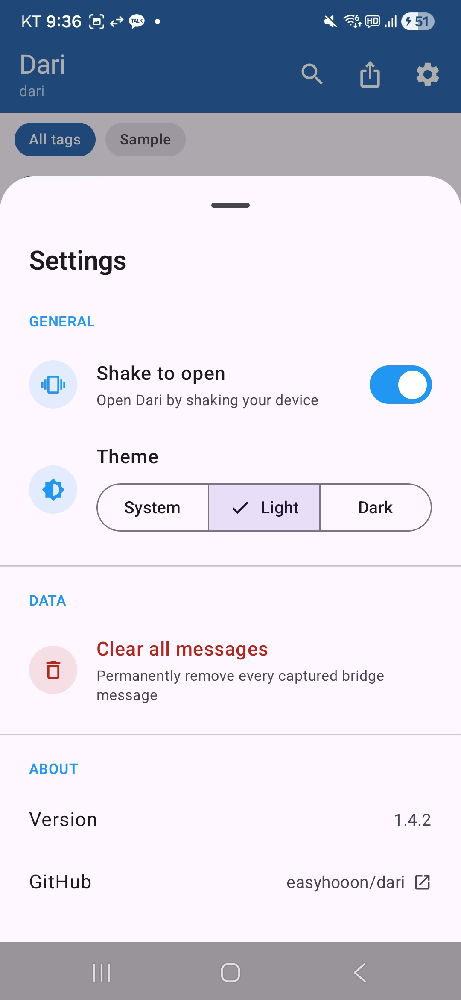
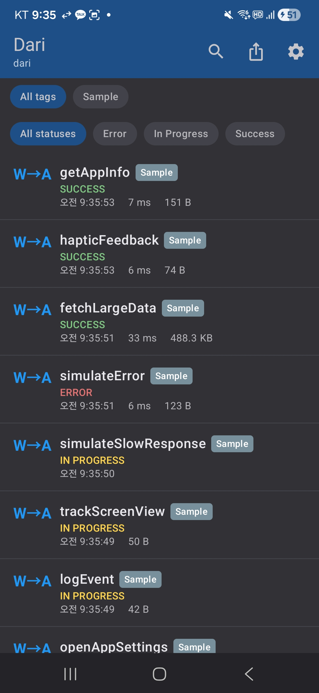
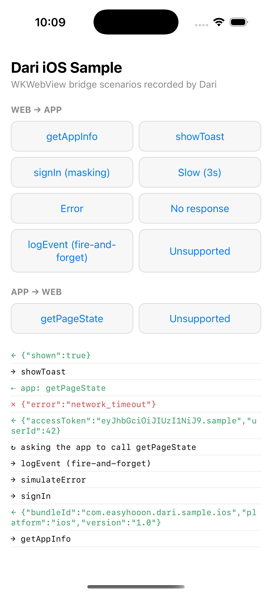
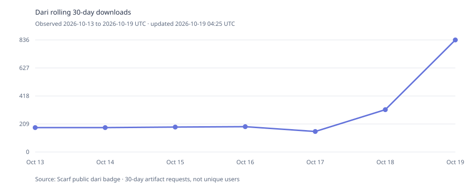

[](https://androidweekly.net/issues/issue-748)
# Dari

[English](README.md) | **한국어**

[](https://central.sonatype.com/artifact/io.github.easyhooon/dari)
[](https://swiftpackageindex.com/easyhooon/dari)
[](https://swiftpackageindex.com/easyhooon/dari)
[](https://easyhooon.github.io/dari/ko/docs)
[](https://gitdiagram.com/easyhooon/dari?utm_source=readme&utm_medium=badge)

**Dari**는 한국어 **"다리(bridge)"** 에서 이름을 따왔습니다. Android·iOS 앱의 WebView 브릿지 통신을 실시간으로 검사하는 도구입니다.

Dari는 웹 콘텐츠와 네이티브 코드 사이의 **WebView JavaScript 브릿지 메시지**를 캡처해, 요청과 응답을 짝지어 보여 줍니다. **Dari 데스크톱 앱**은 macOS, Windows, Linux에서 Android와 iOS 앱의 메시지를 모두 보여 줍니다. Android와 iOS 앱은 기기 안의 인스펙터로도 확인할 수 있습니다.

📥 **[데스크톱 앱 다운로드](https://easyhooon.github.io/dari/ko/download)** · 📖 **[문서](https://easyhooon.github.io/dari/ko/docs)** — 설정 가이드, 구성 레퍼런스, API 문서.

## 데스크톱 앱

연결된 디버그 빌드의 브릿지 메시지를 컴퓨터의 큰 화면에서 확인하세요. 프록시·인증서·포트 설정이 필요 없습니다. Android 앱은 adb로, iOS 앱은 Mac에서 Simulator나 USB 기기로 연결됩니다.

https://github.com/user-attachments/assets/b7332358-953b-4391-9f68-4e547efcb9e7

<p align="center">
  
</p>

- 두 플랫폼을 하나의 인스펙터로: Android 기기·에뮬레이터, iOS Simulator·USB 기기의 실시간 메시지, 요청과 응답을 나란히 표시
- 모두 펼치기 / 모두 접기와 원클릭 복사를 지원하는 접이식 JSON, 텍스트·JSON 내보내기
- 핸들러별 응답 시간 보기: 호출·에러 수와 평균/최소/최대, 느린 순 정렬, 평균 500ms 이상 강조
- 토큰, 비밀번호, 쿠키 마스킹(선택). 데이터가 기기를 떠나기 전에 기기에서 적용
- 지원하는 모든 OS에서 앱 내 업데이트

| OS | 아키텍처 | 다운로드 | 검사 대상 | 비고 |
| --- | --- | --- | --- | --- |
| macOS 10.15+ | Apple Silicon, Intel | `.dmg` 또는 설치 스크립트 | Android, iOS | 서명 및 공증 |
| Windows | x64 | `.exe`, 그룹 정책·Intune 배포용 `.msi` | Android | 코드 서명이 없어 첫 실행 시 SmartScreen 경고가 뜰 수 있음 |
| Linux(미리보기) | x64 | `.deb`(Debian 13, Ubuntu 24.04+) 또는 `.tar.gz`(그 외 배포판) | Android | Debian 13, Xfce, X11에서 테스트 |

Android 앱은 모든 OS에서 `adb`로 연결됩니다. iOS 앱은 Mac이 필요합니다. Simulator는 macOS에서만 돌고, USB 기기는 macOS의 usbmuxd를 통해 연결되기 때문입니다. iOS는 Wi-Fi 연결을 제공하지 않습니다.

Android는 앱의 디버그 빌드에 `dari` 2.0.0 이상, iOS는 `Dari` Swift 패키지 3.0.0 이상이 필요합니다. 1.x를 쓰는 Android 앱은 업그레이드해야 연결됩니다.

macOS에서는 터미널로 설치할 수 있습니다:

```bash
curl -fsSL https://raw.githubusercontent.com/easyhooon/dari/main/scripts/install-desktop.sh | bash
```

요구 사항과 문제 해결은 [데스크톱 앱 가이드](https://easyhooon.github.io/dari/ko/docs/desktop)를 참고하세요.

## 플랫폼 지원

| | Android | iOS |
| --- | --- | --- |
| 패키지 | `dari` + `dari-noop`(Maven Central) | `Dari` Swift 패키지(SPM, 3.0.0+) |
| 최소 OS | Android 8.0(API 26) | iOS 16 |
| Web → App / App → Web 캡처 | ✅ | ✅ |
| 태그, `displayName`, fire-and-forget, 페이지 URL, 환경 라벨 | ✅ | ✅ |
| 직접 호출 없이 캡처 | Gradle 플러그인(2.6.0+) | `autoCapture`(3.1.0+) 또는 `@DariBridge` 매크로(3.2.0+) |
| 앱 내 인스펙터(목록, 상세, 알림, 흔들어 열기, 런처 바로가기) | ✅ | △ 목록, 상세, 검색, 내보내기. 디버그 메뉴에서 열기 |
| 데스크톱 앱 | ✅ adb로 기기·에뮬레이터 연결, macOS·Windows·Linux | ✅ Simulator·USB 기기, macOS 전용 |
| 민감 정보 마스킹 | ✅ 앱 내, 데스크톱 | ✅ 앱 내, 데스크톱. 데스크톱용 직접 규칙(`setPayloadRedactor`) 포함 |
| 텍스트 / JSON 내보내기 | ✅ 앱 내, 데스크톱 | ✅ 앱 내, 데스크톱 |
| Protocol Buffers 검사 | ✅ | ✅ 인터셉터 직접 호출 |
| `retentionPeriod` 정리 | ✅ | ✅ |
| 재실행 후에도 메시지 유지 | ✅ | ✅ `persistsMessages`로 켜기 |
| 릴리스 빌드 | `dari-noop`(같은 API, 캡처 코드 없음) | `#if DEBUG` 안에서만 `start()` 호출 |

## 왜 Dari인가요?

웹뷰를 띄워 쓰는 앱을 디버깅하다 보면 브릿지 핸들러마다 로그를 심고, Logcat이나 Xcode 콘솔을 스크롤하며 요청과 응답을 직접 짝지어야 합니다. Dari를 쓰면:

- 모든 Web ↔ App 브릿지 호출을 한 목록에서 보고, 요청과 응답이 `requestId`로 짝지어 표시됩니다
- JSON 페이로드 정렬 표시, 상태(`IN_PROGRESS` / `SUCCESS` / `ERROR`), 소요 시간을 확인할 수 있습니다
- macOS, Windows, Linux에서 Android와 iOS를 하나의 데스크톱 앱으로 검사합니다
- Android에서는 실시간 알림과 흔들어 열기로, 테스트 중에도 탭 한 번이면 앱 내 인스펙터를 열 수 있습니다
- iOS에서는 디버그 메뉴에서 여는 앱 내 인스펙터(`DariUI`)로, Mac 없이 기기만으로 확인할 수 있습니다
- 프로덕션에는 아무것도 포함되지 않습니다: Android는 `dari-noop`, iOS는 `#if DEBUG`

## 빠른 시작

### Android

```kotlin
// app/build.gradle.kts
debugImplementation("io.github.easyhooon:dari:<latest-version>")
releaseImplementation("io.github.easyhooon:dari-noop:<latest-version>")
```

Dari는 `androidx.startup`으로 스스로 초기화됩니다. 인터셉터는 핸들러마다가 아니라, 요청이 브릿지로 들어오는 곳과 응답이 나가는 곳에서 호출하세요:

```kotlin
val interceptor = Dari.createInterceptor(tag = "main")

@JavascriptInterface
fun onBridgeRequest(handlerName: String, requestId: String, data: String?) {
    interceptor?.onWebToAppRequest(handlerName, requestId, data)
    // … 핸들러로 분기, 응답은 sendResponseToWeb으로
}

private fun sendResponseToWeb(handlerName: String, requestId: String, isSuccess: Boolean, data: String) {
    interceptor?.onWebToAppResponse(handlerName, requestId, data, isSuccess)
    // … evaluateJavascript
}
```

앱을 실행해 브릿지 호출을 일으킨 뒤 Dari 알림을 탭하거나 데스크톱 앱을 여세요. 브릿지 코드에 Dari 호출을 넣고 싶지 않다면, 선택 사항인 [Gradle 플러그인](https://easyhooon.github.io/dari/ko/docs/gradle-plugin)(2.6.0+)이 빌드 시점에 이 호출을 넣어 줍니다.

### iOS

`https://github.com/easyhooon/dari`를 Swift 패키지로 추가하고(`3.0.0`부터) `Dari` 라이브러리를 연결합니다:

```swift
import Dari

#if DEBUG
try? Dari.shared.start()
#endif

let dari = Dari.shared.interceptor(tag: "main")

// WKScriptMessageHandler
func userContentController(_ controller: WKUserContentController, didReceive message: WKScriptMessage) {
    dari.onWebToAppRequest(handlerName: message.name, requestId: callbackId, requestData: json)
    // … 처리 후 응답
    dari.onWebToAppResponse(handlerName: message.name, requestId: callbackId, responseData: result, isSuccess: true)
}
```

Simulator나 USB로 연결한 기기에서 앱을 실행하고, 같은 Mac에서 데스크톱 앱을 여세요. 직접 호출 없이 기록하려면 `start()`에 `autoCapture`(3.1.0+)를 넘기거나, `DariMacros`의 `@DariBridge`(3.2.0+)로 핸들러를 표시하세요. Mac 없이 기기에서 바로 보려면 `DariUI`도 연결하고 `Dari.shared.presentInspector()`를 호출하세요(3.5.0+).

## 가이드

| | Android | iOS |
| --- | --- | --- |
| 설정 | [설정](https://easyhooon.github.io/dari/ko/docs/setup) | [iOS 가이드](https://easyhooon.github.io/dari/ko/docs/ios) |
| 직접 호출 없이 캡처 | [Gradle 플러그인](https://easyhooon.github.io/dari/ko/docs/gradle-plugin) | [자동 수집](https://easyhooon.github.io/dari/ko/docs/ios/capture#자동-수집), [매크로](https://easyhooon.github.io/dari/ko/docs/ios/capture#매크로로-컴파일-시점-수집) |
| API | [인터셉터](https://easyhooon.github.io/dari/ko/docs/interceptor), [구성과 런타임 API](https://easyhooon.github.io/dari/ko/docs/configuration) | [iOS 가이드](https://easyhooon.github.io/dari/ko/docs/ios/capture#브릿지-호출-기록) |
| 더 보기 | [Protocol Buffers](https://easyhooon.github.io/dari/ko/docs/protobuf), [앱 내 인스펙터](https://easyhooon.github.io/dari/ko/docs/inspector), [모듈](https://easyhooon.github.io/dari/ko/docs/modules) | [앱 내 인스펙터](https://easyhooon.github.io/dari/ko/docs/ios#앱-내-인스펙터), [Staging 빌드](https://easyhooon.github.io/dari/ko/docs/ios/connection#staging-빌드), [문제 해결](https://easyhooon.github.io/dari/ko/docs/ios/connection#문제-해결) |

두 플랫폼 공통: [데스크톱 앱](https://easyhooon.github.io/dari/ko/docs/desktop) · [마스킹](https://easyhooon.github.io/dari/ko/docs/masking)

## 앱 내 인스펙터

iOS 앱도 `DariUI` 라이브러리(3.5.0+)로 기기에서 볼 수 있습니다. 검색되는 목록, 개요 / 요청 / 응답, 텍스트·JSON 내보내기를 지원하고, 앱의 디버그 메뉴에서 엽니다. [iOS 가이드](https://easyhooon.github.io/dari/ko/docs/ios#앱-내-인스펙터)를 참고하세요. 아래 내용은 Android 기준입니다.

Android 앱은 [Chucker](https://github.com/ChuckerTeam/chucker)에서 영감을 받은 기기 안 인스펙터도 쓸 수 있습니다: 최근 브릿지 활동을 보여 주는 실시간 알림, 상태·핸들러·태그 필터와 검색을 지원하는 목록, 개요 / 요청 / 응답 탭, 핸들러별 응답 시간, 텍스트·JSON 내보내기, 흔들어 열기, 런처 바로가기, 다크 모드.

<p align="center">
  
</p>

<table>
  <tr>
    <td align="center"><b>런처 바로가기</b></td>
    <td align="center"><b>알림</b></td>
    <td align="center"><b>메시지 목록</b></td>
  </tr>
  <tr>
    <td></td>
    <td></td>
    <td></td>
  </tr>
  <tr>
    <td align="center"><b>개요</b></td>
    <td align="center"><b>요청</b></td>
    <td align="center"><b>응답</b></td>
  </tr>
  <tr>
    <td></td>
    <td></td>
    <td></td>
  </tr>
  <tr>
    <td align="center"><b>태그 필터</b></td>
    <td align="center"><b>설정</b></td>
    <td align="center"><b>다크 모드</b></td>
  </tr>
  <tr>
    <td></td>
    <td></td>
    <td></td>
  </tr>
</table>

## 샘플 앱

- `sample/`(Android): 앱/기기 정보, 토스트, 햅틱, 공유 시트, 클립보드, 앱 설정, 카메라 권한 시나리오를 담은 WebView 데모. Gradle 플러그인으로 브릿지를 캡처합니다.
- `sample-ios/`(iOS): 성공, 에러, 느린 응답, 무응답, fire-and-forget, 마스킹 시나리오를 담은 WKWebView 데모. `@DariBridge`로 브릿지를 캡처합니다. Xcode 16 이상에서 열고 Simulator에서 **DariSample** 스킴을 실행하세요.

<p align="center">
  
</p>

## 보안 및 개인정보

Dari는 디버그 빌드와 내부 빌드용입니다. 브릿지 페이로드에는 토큰, 개인정보 등 민감한 값이
들어 있을 수 있으므로, 내보낸 메시지는 먼저 검토한 뒤 공유하세요. 릴리스 빌드에서는
`dari-noop`을 사용하면 같은 API를 유지하면서 브릿지 메시지를 저장하거나 표시하지 않습니다.
iOS에서는 검사하는 빌드에서만 `Dari.shared.start()`를 호출하세요. 실행 중에는 기기의 루프백에
접근할 수 있는 모든 프로세스가 기록된 메시지를 읽을 수 있습니다.

데스크톱 앱은 기본으로 Sentry에 크래시 리포트를 보냅니다: 예외 타입, 스택 트레이스, OS·아키텍처·Java
버전. 예외 메시지, 브릿지 메시지, 호스트 이름, IP 주소는 보내지 않습니다. 설정 → Privacy →
**Send crash reports**에서 끌 수 있습니다.

## 프로젝트 통계

### Star History

`easyhooon/dari`의 GitHub 스타 추이입니다. 이 실시간 차트는 라이브러리 다운로드 수가 아니라 저장소 스타 수를 보여 줍니다.

<a href="https://www.star-history.com/#easyhooon/dari&amp;Date">
  <picture>
    <source media="(prefers-color-scheme: dark)" srcset="https://api.star-history.com/svg?repos=easyhooon%2Fdari&amp;type=Date&amp;theme=dark" />
    
  </picture>
</a>

### 다운로드 추이

[](https://app.scarf.sh/packages/Easyhooon/repository-jvm/io.github.easyhooon%2Fdari)



Scarf로 매일 관측한 `io.github.easyhooon:dari`의 직전 30일 Maven Central 요청 수입니다. [측정 방식](scripts/README-downloads.md)을 참고하세요.

## 후원

Dari가 디버깅 시간을 줄여 주었다면 저장소에 스타를 누르거나,
[Ko-fi에서 커피를 사 주거나](https://ko-fi.com/easyhooon)
[GitHub Sponsors로 후원](https://github.com/sponsors/easyhooon)할 수 있습니다.

## 라이선스

```
Copyright 2026 easyhooon

Licensed under the Apache License, Version 2.0 (the "License");
you may not use this file except in compliance with the License.
You may obtain a copy of the License at

    http://www.apache.org/licenses/LICENSE-2.0

Unless required by applicable law or agreed to in writing, software
distributed under the License is distributed on an "AS IS" BASIS,
WITHOUT WARRANTIES OR CONDITIONS OF ANY KIND, either express or implied.
See the License for the specific language governing permissions and
limitations under the License.
```
