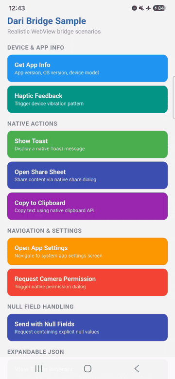
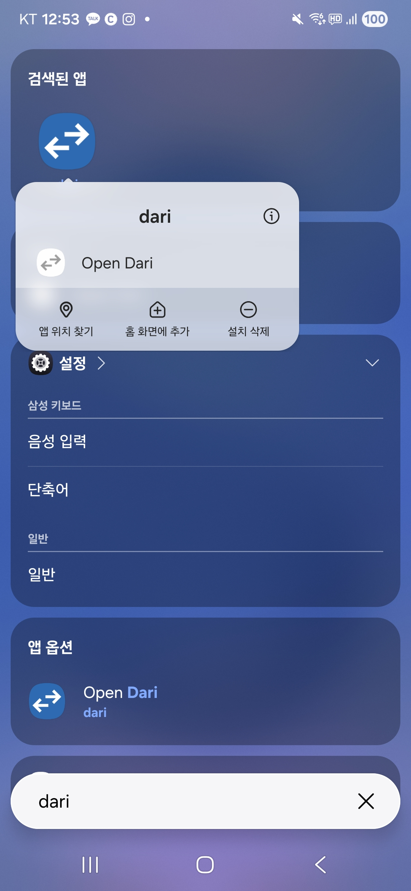
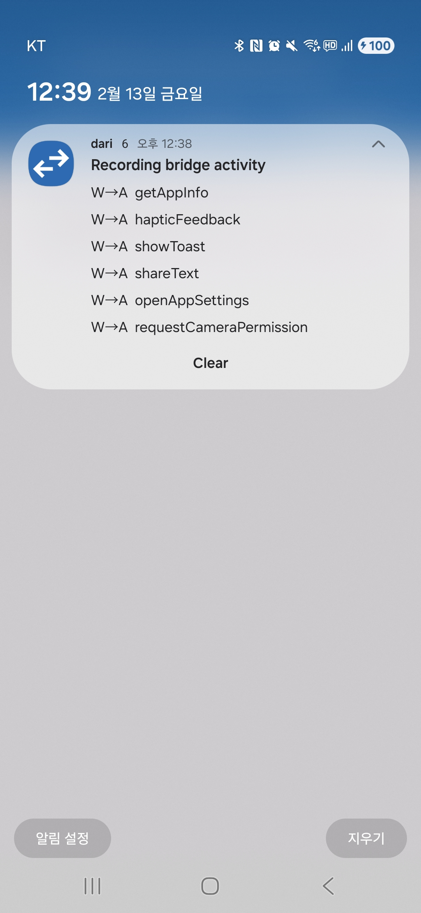
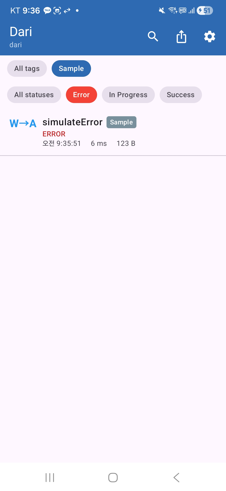
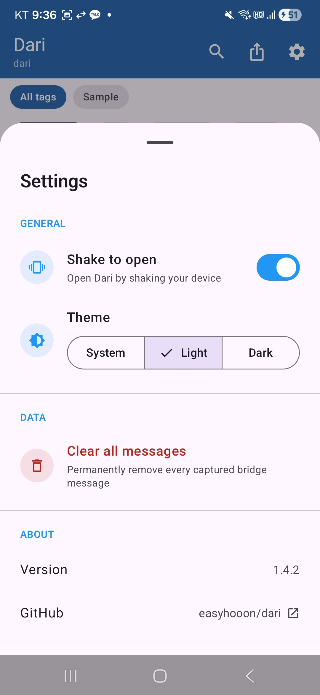
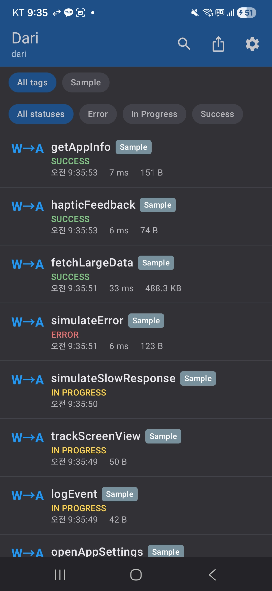
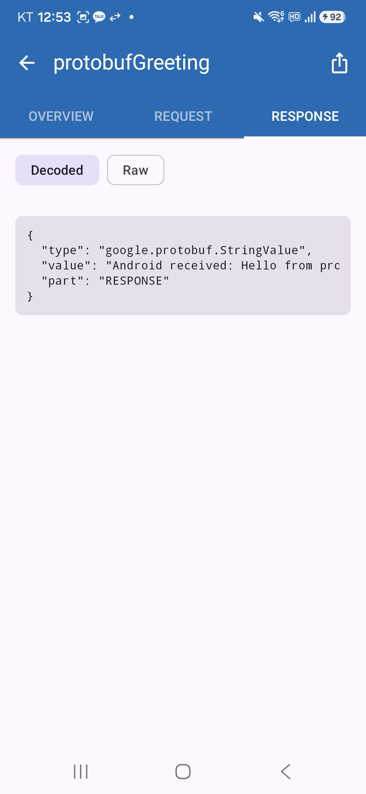
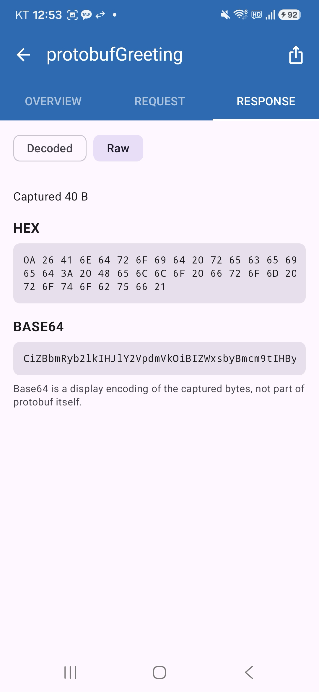

[](https://androidweekly.net/issues/issue-748)
# Dari

[English](README.md) | **한국어**

[](https://central.sonatype.com/artifact/io.github.easyhooon/dari)
[](https://easyhooon.github.io/dari/ko/docs)
[](https://gitdiagram.com/easyhooon/dari?utm_source=readme&utm_medium=badge)

**Dari**는 한국어 **"다리(bridge)"** 에서 이름을 따왔습니다. [Chucker](https://github.com/ChuckerTeam/chucker)에서 영감을 받은, WebView 브릿지 통신을 실시간으로 검사하는 Android 라이브러리입니다.

Chucker가 HTTP 트래픽을 가로채 보여 주듯, Dari는 웹 콘텐츠와 네이티브 Android 코드 사이의 **WebView JavaScript 브릿지 메시지**를 캡처하고 시각화합니다.

📖 **[문서](https://easyhooon.github.io/dari/ko/docs)** — 설정 가이드, 구성 레퍼런스, API 문서.

## 데모

**📱 기기에서: 브릿지 호출 → 알림 → 메시지 상세**

<p align="center">
  
</p>

**🖥️ 컴퓨터에서: adb로 연결하는 데스크톱 앱**

https://github.com/user-attachments/assets/b7332358-953b-4391-9f68-4e547efcb9e7

## 왜 Dari인가요?

하이브리드 앱을 디버깅하다 보면 `@JavascriptInterface` 메서드마다 `Log.d`를 심고, Logcat을 스크롤하며 요청과 응답을 직접 짝지어야 합니다. Dari를 쓰면:

- 모든 Web ↔ App 브릿지 호출을 한 목록에서 보고, 요청과 응답이 `requestId`로 짝지어 표시됩니다
- JSON 페이로드 정렬 표시, 상태(`IN_PROGRESS` / `SUCCESS` / `ERROR`), 소요 시간을 확인할 수 있습니다
- 실시간 알림과 흔들어 열기로, 테스트 중에도 탭 한 번이면 인스펙터를 열 수 있습니다
- 릴리스 빌드에는 no-op 아티팩트를 쓰므로 프로덕션에는 아무것도 포함되지 않습니다

## 빠른 시작

```kotlin
// build.gradle.kts
debugImplementation("io.github.easyhooon:dari:<latest-version>")
releaseImplementation("io.github.easyhooon:dari-noop:<latest-version>")
```

```kotlin
// 브릿지 레이어에서
val interceptor = Dari.createInterceptor()

interceptor?.onWebToAppRequest(handlerName, requestId, data)
interceptor?.onWebToAppResponse(handlerName, requestId, responseData, isSuccess)
```

앱을 실행하고 브릿지 호출을 일으킨 뒤 Dari 알림을 탭하세요. App-to-Web 메시지, 태그, Protocol Buffers는 [설정](#설정)을 참고하세요.


## 데스크톱 앱

연결된 디버그 빌드의 브릿지 메시지를 컴퓨터의 큰 화면에서 확인하세요. adb만 있으면 되고, 프록시·인증서·포트 설정이 필요 없습니다.

- USB로 연결한 기기나 에뮬레이터의 실시간 메시지, 요청과 응답을 나란히 표시
- 모두 펼치기 / 모두 접기와 원클릭 복사를 지원하는 접이식 JSON, 텍스트·JSON 내보내기
- 핸들러별 응답 시간 보기: 호출·에러 수와 평균/최소/최대, 느린 순 정렬, 평균 500ms 이상 강조
- 토큰, 비밀번호, 쿠키 마스킹(선택). 데이터가 기기를 떠나기 전에 기기에서 적용
- macOS(서명 및 공증, Apple Silicon·Intel), Windows, Linux(미리보기), 앱 내 업데이트 지원

앱의 디버그 빌드에 `dari` 2.0.0 이상이 필요합니다. 1.x를 쓰는 앱은 업그레이드해야 연결됩니다.

📥 **[다운로드](https://easyhooon.github.io/dari/ko/download)** 또는 터미널에서 설치:

```bash
curl -fsSL https://raw.githubusercontent.com/easyhooon/dari/main/scripts/install-desktop.sh | bash
```

요구 사항과 문제 해결은 [데스크톱 앱 가이드](https://easyhooon.github.io/dari/ko/docs/desktop)를 참고하세요.

## 스크린샷

<table>
  <tr>
    <td align="center"><b>런처 바로가기</b></td>
    <td align="center"><b>알림</b></td>
    <td align="center"><b>메시지 목록</b></td>
  </tr>
  <tr>
    <td></td>
    <td></td>
    <td></td>
  </tr>
  <tr>
    <td align="center"><b>개요</b></td>
    <td align="center"><b>요청</b></td>
    <td align="center"><b>응답</b></td>
  </tr>
  <tr>
    <td></td>
    <td></td>
    <td></td>
  </tr>
  <tr>
    <td align="center"><b>태그 필터</b></td>
    <td align="center"><b>설정</b></td>
    <td align="center"><b>다크 모드</b></td>
  </tr>
  <tr>
    <td></td>
    <td></td>
    <td></td>
  </tr>
</table>

## 기능

- Web-to-App, App-to-Web 브릿지 메시지 가로채기
- 여러 WebView/Activity 환경에서 메시지 출처를 구분하는 **태그 지원**
- **메시지 상태 추적** — `IN_PROGRESS`, `SUCCESS`, `ERROR`를 색상으로 구분
- **상태 필터링** — 칩으로 상태별 메시지 필터링
- **응답 시간 통계** — 핸들러별 호출 수, 평균·최소·최대 응답 시간, 느린 핸들러 강조
- 최근 브릿지 활동을 보여 주는 Chucker 스타일 상시 알림
- 검색, 핸들러 이름 필터, **태그 기반 필터링**을 지원하는 메시지 목록 UI
- 개요 / 요청 / 응답 탭으로 구성된 상세 화면
- 요청·응답 페이로드 JSON 정렬 출력
- 앱이 제공하는 디코더를 통한 Protocol Buffers 검사(선택)
- 메시지를 텍스트 또는 JSON으로 내보내기
- **흔들어서 열기** — 기기를 흔들면 Dari UI 실행(햅틱 피드백 포함)
- **다크 모드** — 시스템 / 라이트 / 다크 테마 전환
- **설정 바텀 시트** — 흔들기 토글, 테마 선택, 데이터 삭제, 버전 정보
- 빠르게 접근할 수 있는 동적 런처 바로가기
- no-op 모듈로 릴리스 빌드 오버헤드 없음
- `androidx.startup`을 통한 자동 초기화

## 설정

### Gradle

앱의 `build.gradle.kts`에 `dari`(debug)와 `dari-noop`(release) 의존성을 추가합니다:

```kotlin
dependencies {
    debugImplementation("io.github.easyhooon:dari:<latest-version>")
    releaseImplementation("io.github.easyhooon:dari-noop:<latest-version>")
}
```

초기화는 이것으로 끝입니다. 앱이 시작될 때 Dari가 `androidx.startup`으로 자동 초기화됩니다.

### 인터셉터 연동

Dari는 WebView 브릿지 레이어에 인터셉터를 **직접 주입**해야 합니다. 인터셉터 인스턴스를 만들고 브릿지 통신 코드의 적절한 지점에서 메서드를 호출하세요.

#### 1. 인터셉터 생성

```kotlin
import com.easyhooon.dari.Dari
import com.easyhooon.dari.interceptor.DariInterceptor

// Basic usage (no tag)
val interceptor: DariInterceptor? = Dari.createInterceptor()

// With tag — identifies the source in multi-WebView/Activity environments
val paymentInterceptor: DariInterceptor? = Dari.createInterceptor(tag = "PaymentWebView")
val mainInterceptor: DariInterceptor? = Dari.createInterceptor(tag = "MainWebView")
```

`tag`를 지정하면 해당 인터셉터가 캡처한 모든 메시지에 태그가 자동으로 붙습니다. 태그는 메시지 목록에 칩으로 표시되며, 출처별로 메시지를 필터링하는 데 쓸 수 있습니다.

#### 2. Web-to-App 메시지 가로채기

`@JavascriptInterface` 메서드에서 요청이 도착했을 때와 응답이 준비된 뒤에 인터셉터를 호출합니다:

```kotlin
// When a request is received from JavaScript
interceptor?.onWebToAppRequest(handlerName, requestId, data)

// After processing, log the response
interceptor?.onWebToAppResponse(handlerName, requestId, responseData, isSuccess)
```

#### 3. App-to-Web 메시지 가로채기

네이티브 코드가 JavaScript로 메시지를 보낼 때와 응답이 돌아왔을 때 인터셉터를 호출합니다:

```kotlin
// When sending a message to JavaScript
interceptor?.onAppToWebRequest(handlerName, requestId, data)

// When the web response is received
interceptor?.onAppToWebResponse(requestId, isSuccess, responseData)
```

#### 4. Fire-and-Forget 메시지 (requestId 선택)

응답이 필요 없는 메시지(예: 분석 이벤트, 화면 추적)는 `requestId`로 `null`을 넘길 수 있습니다:

```kotlin
// Fire-and-forget: no response expected
interceptor?.onWebToAppRequest(handlerName, null, data)
// No need to call onWebToAppResponse
```

`requestId`가 `null`이면 메시지는 단독 메시지로 처리되고 응답과 매칭되지 않습니다.

#### 5. Protocol Buffers (선택)

기존 `String`/JSON 메서드는 그대로입니다. protobuf 페이로드를 검사하려면 앱이 제공하는 디코더로 인터셉터를 생성하세요:

protobuf 기능 플래그나 `DariConfig` 토글은 없습니다. 이 인터셉터 오버로드와 protobuf 캡처 메서드를 사용하면 해당 브릿지에서 protobuf 검사가 활성화됩니다. 자세한 내용은 [한국어 가이드](https://easyhooon.github.io/dari/ko/docs/protobuf) 또는 [영어 가이드](https://easyhooon.github.io/dari/docs/protobuf)를 참고하세요.

```kotlin
import com.easyhooon.dari.interceptor.protobufDecoder

val protobufInterceptor = Dari.createInterceptor(
    tag = "OrderBridge",
    protobufDecoder = protobufDecoder {
        webToApp("createOrder") {
            request { JsonFormat.printer().print(CreateOrderRequest.parseFrom(it)) }
            response { JsonFormat.printer().print(CreateOrderResponse.parseFrom(it)) }
        }
    },
)

protobufInterceptor?.onWebToAppProtobufRequest(
    handlerName = "createOrder",
    requestId = requestId,
    requestData = protobufBytes,
)
```

Dari는 protobuf 런타임에 의존하지 않습니다. 생성된 메시지 타입과 디코딩은 사용하는 앱이 담당합니다. 디코딩은 인터셉터를 호출한 스레드에서 동기적으로 실행되므로 디코더 작업은 짧게 유지해야 합니다. Base64는 앱의 브릿지가 문자열만 지원할 때만 필요하며, `ArrayBuffer` 브릿지는 바이트를 그대로 넘길 수 있습니다.

REQUEST와 RESPONSE 탭은 `Decoded`와 `Raw` 보기를 제공합니다. Raw 보기는 각 protobuf 페이로드의 처음 4KB만 보관하고 그 미리보기를 Hex와 Base64로 표시하며, 원본 바이트 크기와 잘림 여부는 계속 확인할 수 있습니다. 이 보기의 Base64는 Dari가 표시용으로 만든 인코딩일 뿐, 브릿지가 페이로드를 Base64로 전송했다는 뜻이 아닙니다.

<table>
  <tr>
    <td align="center"><b>Protobuf 디코딩</b></td>
    <td align="center"><b>Protobuf 원시 바이트</b></td>
  </tr>
  <tr>
    <td></td>
    <td></td>
  </tr>
</table>

### 사용자 정의 구성

자동 초기화가 일어나기 전이나 `Application.onCreate()`에서 config와 함께 `init`을 호출해 Dari를 사용자 정의할 수 있습니다:

```kotlin
class MyApp : Application() {
    override fun onCreate() {
        super.onCreate()
        Dari.init(
            context = this,
            config = DariConfig(
                maxEntries = 1000,              // Default: 500
                showNotification = true,        // Default: true
                maxContentLength = 500_000,     // Default: 500,000 (truncate large payloads)
                shakeToOpen = true,             // Default: false
                retentionPeriod = 1.days,       // Default: null (disabled)
                fireAndForget = false,          // Default: false
            )
        )
    }
}
```

| 파라미터 | 타입 | 기본값 | 설명 |
|-----------|------|---------|-------------|
| `maxEntries` | `Int` | `500` | 저장할 최대 메시지 수 |
| `showNotification` | `Boolean` | `true` | 상시 알림 표시 |
| `maxContentLength` | `Int` | `500,000` | 이 길이를 넘는 요청/응답 페이로드를 자름 |
| `shakeToOpen` | `Boolean` | `false` | 흔들어서 Dari UI 열기 활성화 |
| `retentionPeriod` | `Duration?` | `null` | TTL 기반 메시지 정리(예: `1.hours`, `3.days`). `null`이면 비활성화 |
| `fireAndForget` | `Boolean` | `false` | 기본적으로 브릿지 호출을 응답을 기다리지 않는 단방향으로 처리 |

## 모듈 구조

```
dari/
├── dari-core/     ← KMP contracts for Android, JVM, and iOS
├── dari/          ← Debug library (interceptor, UI, notifications)
├── dari-noop/     ← Release no-op (same API surface, zero overhead)
└── sample/        ← Sample app with WebView bridge demo
```

Kotlin Multiplatform 프로젝트에서는 `dari-core`를 `commonMain`에 추가할 수 있습니다:

```kotlin
commonMain.dependencies {
    implementation("io.github.easyhooon:dari-core:<version>")
}
```

이렇게 하면 메시지 모델과 인터셉터 계약을 Android, JVM, iOS 타깃에서 공유합니다. `dari`의 인스펙터 런타임, UI, 저장소, 알림, WebView 연동은 Android 전용입니다.

## 샘플 앱

`sample/` 모듈에는 실제와 비슷한 브릿지 시나리오를 담은 WebView 데모가 있습니다: 앱/기기 정보 조회, 토스트 메시지, 햅틱 피드백, 네이티브 공유 시트, 클립보드 접근, 앱 설정 열기, 카메라 권한 요청. 샘플 앱을 실행해 버튼을 눌러 보고 다음을 확인하세요:

1. 최근 브릿지 메시지를 보여 주는 알림이 나타납니다
2. 알림을 탭하면 메시지 목록이 열립니다
3. 메시지를 탭하면 상세 내용(개요, 요청 페이로드, 응답 페이로드)을 볼 수 있습니다

## 보안 및 개인정보

Dari는 디버그 빌드와 내부 빌드용입니다. 브릿지 페이로드에는 토큰, 개인정보 등 민감한 값이
들어 있을 수 있으므로, 내보낸 메시지는 먼저 검토한 뒤 공유하세요. 릴리스 빌드에서는
`dari-noop`을 사용하면 같은 API를 유지하면서 브릿지 메시지를 저장하거나 표시하지 않습니다.

데스크톱 앱은 기본으로 Sentry에 크래시 리포트를 보냅니다: 예외 타입, 스택 트레이스, OS·아키텍처·Java
버전. 예외 메시지, 브릿지 메시지, 호스트 이름, IP 주소는 보내지 않습니다. 설정 → Privacy →
**Send crash reports**에서 끌 수 있습니다.

## API 레퍼런스

### Dari

| 메서드 | 설명 |
|--------|-------------|
| `init(context, config)` | 사용자 정의 구성으로 초기화 |
| `createInterceptor(tag?)` | 태그(선택)를 지정해 `DariInterceptor` 생성(noop에서는 `null` 반환) |
| `createInterceptor(tag?, protobufDecoder)` | 문자열/JSON 메서드를 모두 유지하면서 protobuf를 지원하는 인터셉터 생성 |
| `setShakeToOpenEnabled(enabled)` | 런타임에 흔들어서 열기 켜기/끄기(저장됨) |
| `setDarkMode(value)` | 다크 모드 재정의: `true` / `false` / `null`(시스템 기본값). 저장됨 |
| `setShowTagChip(show)` | 메시지 목록의 브릿지 태그 칩 표시/숨김. 저장됨 |
| `setEnvironment(vararg labels)` | 캡처 환경 라벨(리전, 웹 빌드, flavor 등). 두 인스펙터와 export에 표시되고, 다시 호출하면 교체됨. 저장되지 않음 |
| `showNotification()` | 알림 표시(예: 권한 허용 후) |
| `clear()` | 저장된 모든 메시지를 지우고 알림 닫기 |

### DariInterceptor

| 메서드 | 설명 |
|--------|-------------|
| `onWebToAppRequest()` | Web-to-App 요청 기록. 별도의 `displayName`(선택)을 받는 오버로드가 있습니다. |
| `onWebToAppResponse()` | Web-to-App 요청에 대한 응답 기록. `requestId`가 null이면 건너뜁니다. |
| `onAppToWebRequest()` | App-to-Web 메시지 기록. 별도의 `displayName`(선택)을 받는 오버로드가 있습니다. |
| `onAppToWebResponse()` | App-to-Web 메시지에 대한 응답 기록. `requestId`가 null이면 건너뜁니다. |
| `onPageUrlChanged(url)` | WebView의 현재 페이지 전달(예: `doUpdateVisitedHistory`). 이후 요청에 기록되어 origin 필터에 쓰입니다. user info, query, fragment는 저장하지 않습니다. |

`ProtobufDariInterceptor`는 이 인터페이스를 확장해 `ByteArray` 페이로드를 받는 `on*ProtobufRequest()`, `on*ProtobufResponse()` 메서드를 제공합니다.

```kotlin
/**
 * Interface for intercepting WebView bridge communication.
 * Injected into WebViewBridge to capture all bridge messages.
 */
interface DariInterceptor {
    /** Tag identifying the source of messages captured by this interceptor */
    val tag: String?
        get() = null

    /** Called when a Web -> App request is received */
    fun onWebToAppRequest(
        handlerName: String,
        requestId: String?,
        requestData: String?,
        fireAndForget: Boolean? = null,
    )

    fun onWebToAppRequest(
        handlerName: String,
        displayName: String?,
        requestId: String?,
        requestData: String?,
        fireAndForget: Boolean? = null,
    )

    /** Called when a response is sent for a Web -> App request */
    fun onWebToAppResponse(
        handlerName: String,
        requestId: String?,
        responseData: String?,
        isSuccess: Boolean,
    )

    /** Called when an App -> Web request is sent */
    fun onAppToWebRequest(
        handlerName: String,
        requestId: String?,
        data: String?,
        fireAndForget: Boolean? = null,
    )

    fun onAppToWebRequest(
        handlerName: String,
        displayName: String?,
        requestId: String?,
        data: String?,
        fireAndForget: Boolean? = null,
    )

    /** Called when a web response is received for an App -> Web request */
    fun onAppToWebResponse(
        requestId: String?,
        isSuccess: Boolean,
        responseData: String?,
    )
}
```

## 프로젝트 통계

### Star History

`easyhooon/dari`의 GitHub 스타 추이입니다. 이 실시간 차트는 라이브러리 다운로드 수가 아니라 저장소 스타 수를 보여 줍니다.

<a href="https://www.star-history.com/#easyhooon/dari&amp;Date">
  <picture>
    <source media="(prefers-color-scheme: dark)" srcset="https://api.star-history.com/svg?repos=easyhooon%2Fdari&amp;type=Date&amp;theme=dark" />
    
  </picture>
</a>

### 다운로드 추이

[](https://app.scarf.sh/packages/Easyhooon/repository-jvm/io.github.easyhooon%2Fdari)


Scarf로 매일 관측한 `io.github.easyhooon:dari`의 직전 30일 Maven Central 요청 수입니다. [측정 방식](scripts/README-downloads.md)을 참고하세요.

## 후원

Dari가 디버깅 시간을 줄여 주었다면 저장소에 스타를 누르거나,
[Ko-fi에서 커피를 사 주거나](https://ko-fi.com/easyhooon)
[GitHub Sponsors로 후원](https://github.com/sponsors/easyhooon)할 수 있습니다.

## 라이선스

```
Copyright 2026 easyhooon

Licensed under the Apache License, Version 2.0 (the "License");
you may not use this file except in compliance with the License.
You may obtain a copy of the License at

    http://www.apache.org/licenses/LICENSE-2.0

Unless required by applicable law or agreed to in writing, software
distributed under the License is distributed on an "AS IS" BASIS,
WITHOUT WARRANTIES OR CONDITIONS OF ANY KIND, either express or implied.
See the License for the specific language governing permissions and
limitations under the License.
```
