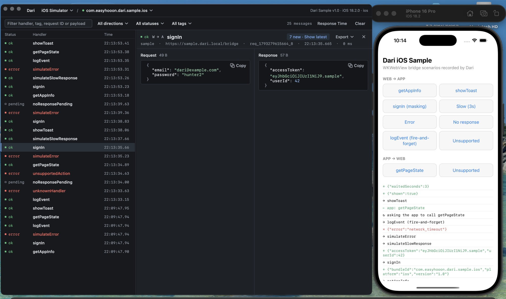
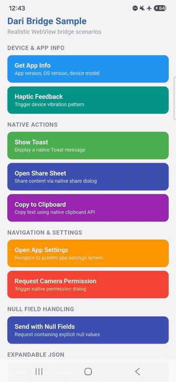
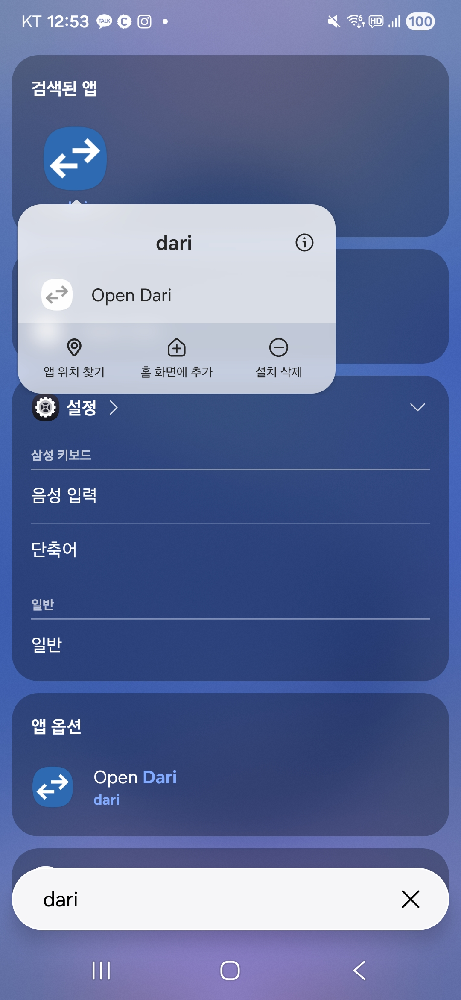
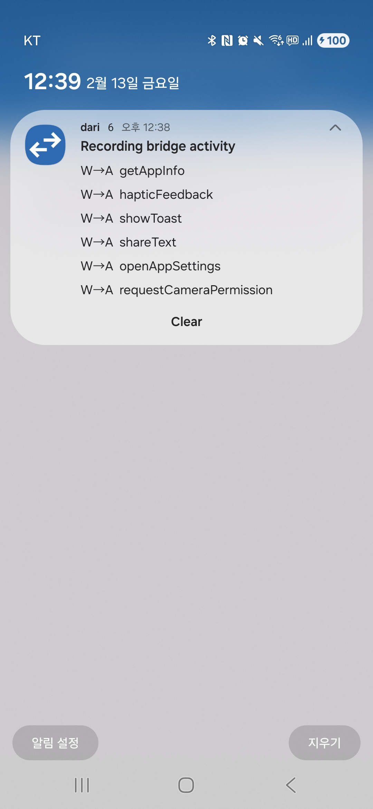
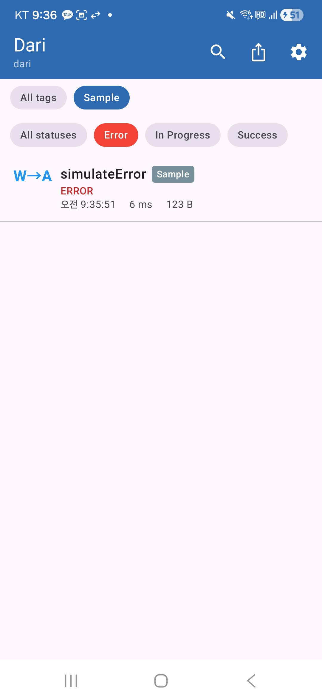
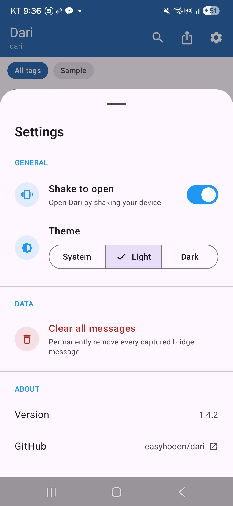
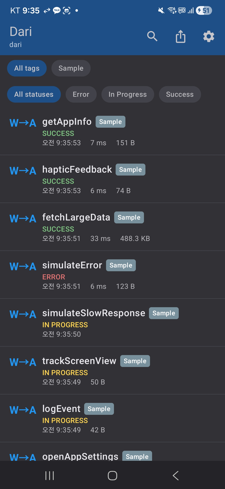
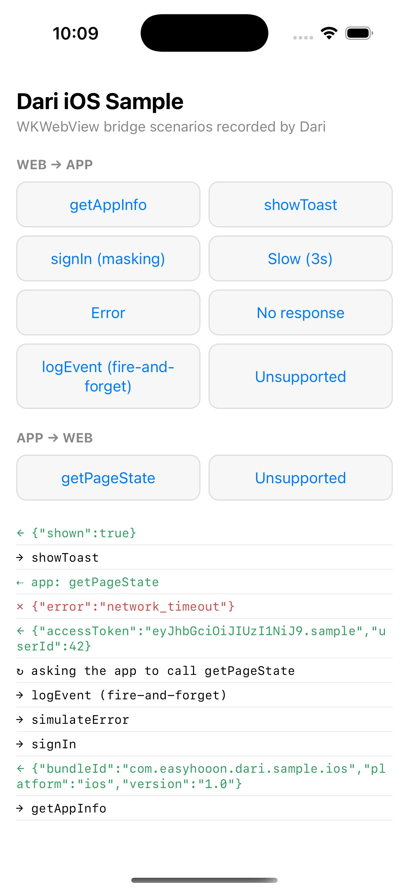
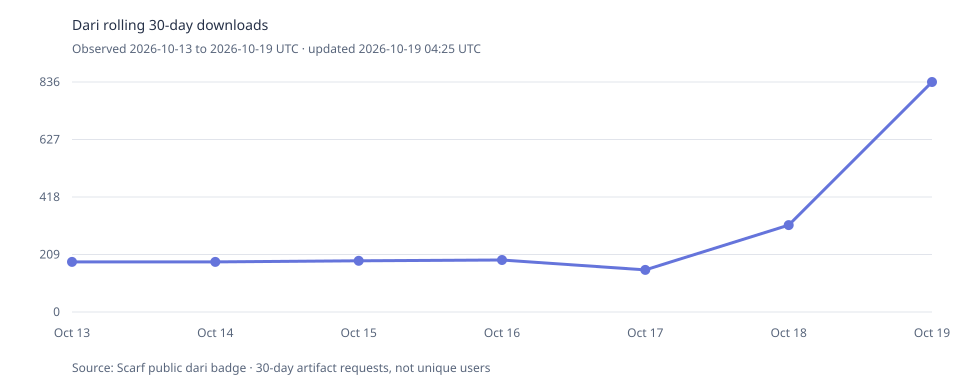

[](https://androidweekly.net/issues/issue-748)
# Dari

**English** | [한국어](README.ko.md)

[](https://central.sonatype.com/artifact/io.github.easyhooon/dari)
[](https://swiftpackageindex.com/easyhooon/dari)
[](https://swiftpackageindex.com/easyhooon/dari)
[](https://easyhooon.github.io/dari)
[](https://gitdiagram.com/easyhooon/dari?utm_source=readme&utm_medium=badge)

**Dari** (다리) means **"bridge"** in Korean. Dari is a tool for inspecting WebView bridge communication in Android and iOS apps in real time, inspired by [Chucker](https://github.com/ChuckerTeam/chucker).

Just as Chucker intercepts and displays HTTP traffic, Dari captures and visualizes **WebView JavaScript bridge messages** between your web content and native code. The **Dari Desktop App** shows them from Android and iOS apps alike, on macOS, Windows and Linux. Android apps also get an in-app inspector on the device.

📥 **[Download the Desktop App](https://easyhooon.github.io/dari/download)** · 📖 **[Documentation](https://easyhooon.github.io/dari)** — Setup guide, configuration reference, and API docs.

## Desktop App

See the bridge messages of a connected debug build on your computer, on a bigger screen. No proxy, certificate or port setup: Android apps connect over adb, iOS apps from a Simulator or a USB device on a Mac.

https://github.com/user-attachments/assets/b7332358-953b-4391-9f68-4e547efcb9e7

<p align="center">
  
</p>

- One inspector for both platforms: live messages from an Android device or emulator, or an iOS Simulator or USB device, with the request and response side by side
- Foldable JSON with Expand all / Collapse all and one-click Copy, plus text and JSON export
- Response Time view per handler: calls, errors and avg/min/max, slowest first, with averages of 500 ms or more highlighted
- Optional masking of tokens, passwords and cookies, applied on the device before data leaves it
- In-app updates on every supported OS

| OS | Architecture | Download | Inspects | Notes |
| --- | --- | --- | --- | --- |
| macOS 10.15+ | Apple Silicon, Intel | `.dmg` or the install script | Android, iOS | Signed and notarized |
| Windows | x64 | `.exe`, or `.msi` for Group Policy / Intune | Android | Not code-signed, so SmartScreen may warn on first run |
| Linux (preview) | x64 | `.deb` (Debian 13, Ubuntu 24.04+) or `.tar.gz` (other distributions) | Android | Tested on Debian 13 with Xfce on X11 |

Android apps connect through `adb` on every OS. iOS apps need a Mac, because Simulators run only there and USB devices are reached through macOS's usbmuxd; Wi-Fi connections are not offered for iOS.

Requires `dari` 2.0.0 or later in your app's debug build on Android, or the `Dari` Swift package 3.0.0 or later on iOS. Android apps still on 1.x can't connect until they upgrade.

Install from the terminal on macOS:

```bash
curl -fsSL https://raw.githubusercontent.com/easyhooon/dari/main/scripts/install-desktop.sh | bash
```

See the [Desktop App guide](https://easyhooon.github.io/dari/docs/desktop) for requirements and troubleshooting.

## Platform Support

| | Android | iOS |
| --- | --- | --- |
| Package | `dari` + `dari-noop` (Maven Central) | `Dari` Swift package (SPM, 3.0.0+) |
| Minimum OS | Android 8.0 (API 26) | iOS 15 |
| Web → App / App → Web capture | ✅ | ✅ |
| Tags, `displayName`, fire-and-forget, page URL, environment labels | ✅ | ✅ |
| Capture without manual calls | Gradle plugin (2.6.0+) | `autoCapture` (3.1.0+) or `@DariBridge` macro (3.2.0+) |
| In-app inspector (list, detail, notification, shake-to-open, launcher shortcut) | ✅ | ❌ |
| Desktop App | ✅ Device or emulator over adb, on macOS, Windows and Linux | ✅ Simulator or USB device, macOS only |
| Masking of sensitive values | ✅ In-app and desktop | ✅ Desktop, including your own rules (`setPayloadRedactor`) |
| Text / JSON export | ✅ In-app and desktop | ✅ Desktop |
| Protocol Buffers inspection | ✅ | ❌ |
| `retentionPeriod` cleanup | ✅ | ❌ (kept in memory, capped by `maxEntries`) |
| Release builds | `dari-noop` (same API, no capture code) | Call `start()` only under `#if DEBUG` |

## Why Dari?

Debugging a hybrid app usually means sprinkling logs across bridge handlers and scrolling Logcat or the Xcode console to match requests with responses. Dari gives you:

- Every Web ↔ App bridge call in one list, with request/response paired by `requestId`
- Pretty-printed JSON payloads, status (`IN_PROGRESS` / `SUCCESS` / `ERROR`), and timing
- One desktop app for Android and iOS, on macOS, Windows or Linux
- On Android, a live notification and shake-to-open, so the in-app inspector is one tap away while testing
- Nothing in production: `dari-noop` on Android, `#if DEBUG` on iOS

## Quick Start

### Android

```kotlin
// app/build.gradle.kts
debugImplementation("io.github.easyhooon:dari:<latest-version>")
releaseImplementation("io.github.easyhooon:dari-noop:<latest-version>")
```

Dari initializes itself through `androidx.startup`. Call the interceptor where requests enter your bridge and where responses leave it, not in each handler:

```kotlin
val interceptor = Dari.createInterceptor(tag = "main")

@JavascriptInterface
fun onBridgeRequest(handlerName: String, requestId: String, data: String?) {
    interceptor?.onWebToAppRequest(handlerName, requestId, data)
    // … dispatch to handlers, which reply through sendResponseToWeb
}

private fun sendResponseToWeb(handlerName: String, requestId: String, isSuccess: Boolean, data: String) {
    interceptor?.onWebToAppResponse(handlerName, requestId, data, isSuccess)
    // … evaluateJavascript
}
```

Run the app, trigger a bridge call, and tap the Dari notification or open the Desktop App. To keep Dari out of your bridge code, the optional [Gradle plugin](https://easyhooon.github.io/dari/docs/gradle-plugin) (2.6.0+) inserts these calls at build time.

### iOS

Add `https://github.com/easyhooon/dari` as a Swift package (from `3.0.0`) and link the `Dari` library:

```swift
import Dari

#if DEBUG
try? Dari.shared.start()
#endif

let dari = Dari.shared.interceptor(tag: "main")

// WKScriptMessageHandler
func userContentController(_ controller: WKUserContentController, didReceive message: WKScriptMessage) {
    dari.onWebToAppRequest(handlerName: message.name, requestId: callbackId, requestData: json)
    // … handle, then reply
    dari.onWebToAppResponse(handlerName: message.name, requestId: callbackId, responseData: result, isSuccess: true)
}
```

Run the app in a Simulator or on a USB-attached device and open the Desktop App on the same Mac. To skip the manual calls, pass `autoCapture` (3.1.0+) to `start()` or mark the handler with `@DariBridge` from `DariMacros` (3.2.0+).

## Guides

| | Android | iOS |
| --- | --- | --- |
| Setup | [Setup](https://easyhooon.github.io/dari/docs/setup) | [iOS guide](https://easyhooon.github.io/dari/docs/ios) |
| Capture without manual calls | [Gradle plugin](https://easyhooon.github.io/dari/docs/gradle-plugin) | [Automatic capture](https://easyhooon.github.io/dari/docs/ios/capture#automatic-capture), [Macros](https://easyhooon.github.io/dari/docs/ios/capture#compile-time-capture-with-macros) |
| API | [Interceptor](https://easyhooon.github.io/dari/docs/interceptor), [Configuration and runtime API](https://easyhooon.github.io/dari/docs/configuration) | [iOS guide](https://easyhooon.github.io/dari/docs/ios/capture#record-bridge-calls) |
| More | [Protocol Buffers](https://easyhooon.github.io/dari/docs/protobuf), [In-app inspector](https://easyhooon.github.io/dari/docs/inspector), [Modules](https://easyhooon.github.io/dari/docs/modules) | [Staging builds](https://easyhooon.github.io/dari/docs/ios/connection#staging-builds), [Troubleshooting](https://easyhooon.github.io/dari/docs/ios/connection#troubleshooting) |

Both platforms: [Desktop App](https://easyhooon.github.io/dari/docs/desktop) · [Masking](https://easyhooon.github.io/dari/docs/masking)

## In-app Inspector (Android)

Android apps also get an inspector on the device, Chucker-style: a live notification of recent bridge activity, a searchable list with status, handler and tag filters, Overview / Request / Response tabs, per-handler response times, text or JSON export, shake-to-open, a launcher shortcut, and dark mode.

<p align="center">
  
</p>

<table>
  <tr>
    <td align="center"><b>Launcher Shortcut</b></td>
    <td align="center"><b>Notification</b></td>
    <td align="center"><b>Message List</b></td>
  </tr>
  <tr>
    <td></td>
    <td></td>
    <td></td>
  </tr>
  <tr>
    <td align="center"><b>Overview</b></td>
    <td align="center"><b>Request</b></td>
    <td align="center"><b>Response</b></td>
  </tr>
  <tr>
    <td></td>
    <td></td>
    <td></td>
  </tr>
  <tr>
    <td align="center"><b>Tag Filter</b></td>
    <td align="center"><b>Settings</b></td>
    <td align="center"><b>Dark Mode</b></td>
  </tr>
  <tr>
    <td></td>
    <td></td>
    <td></td>
  </tr>
</table>

## Sample Apps

- `sample/` (Android): a WebView demo with app/device info, toast, haptics, share sheet, clipboard, app settings and camera permission scenarios. It captures its bridge with the Gradle plugin.
- `sample-ios/` (iOS): a WKWebView demo with success, error, slow, no-response, fire-and-forget and masking scenarios. It captures its bridge with `@DariBridge`. Open it in Xcode 16 or later and run the **DariSample** scheme on a Simulator.

<p align="center">
  
</p>

## Security & Privacy

Dari is intended for debug and internal builds. Bridge payloads may contain
tokens, personal data, or other sensitive values, so avoid sharing exported
messages without reviewing them first. Use `dari-noop` in release builds to
keep the same API surface without storing or displaying bridge messages.
On iOS, call `Dari.shared.start()` only in builds you inspect: while it runs,
any process that can reach the device's loopback can read the recorded messages.

The desktop app sends crash reports to Sentry by default: the exception type, stack trace, and OS,
architecture and Java versions. Exception messages, bridge messages, host names and IP addresses
are never sent. Turn it off in Settings → Privacy → **Send crash reports**.

## Project Stats

### Star History

GitHub stars for `easyhooon/dari` over time. This live chart shows repository stars, not library downloads.

<a href="https://www.star-history.com/#easyhooon/dari&amp;Date">
  <picture>
    <source media="(prefers-color-scheme: dark)" srcset="https://api.star-history.com/svg?repos=easyhooon%2Fdari&amp;type=Date&amp;theme=dark" />
    
  </picture>
</a>

### Download history

[](https://app.scarf.sh/packages/Easyhooon/repository-jvm/io.github.easyhooon%2Fdari)



Rolling 30-day Maven Central requests for `io.github.easyhooon:dari`, observed daily via Scarf. See [how it is measured](scripts/README-downloads.md).

## Support

If Dari saves you debugging time, you can star the repository,
[buy me a coffee on Ko-fi](https://ko-fi.com/easyhooon) or
[sponsor on GitHub](https://github.com/sponsors/easyhooon).

## License

```
Copyright 2026 easyhooon

Licensed under the Apache License, Version 2.0 (the "License");
you may not use this file except in compliance with the License.
You may obtain a copy of the License at

    http://www.apache.org/licenses/LICENSE-2.0

Unless required by applicable law or agreed to in writing, software
distributed under the License is distributed on an "AS IS" BASIS,
WITHOUT WARRANTIES OR CONDITIONS OF ANY KIND, either express or implied.
See the License for the specific language governing permissions and
limitations under the License.
```
