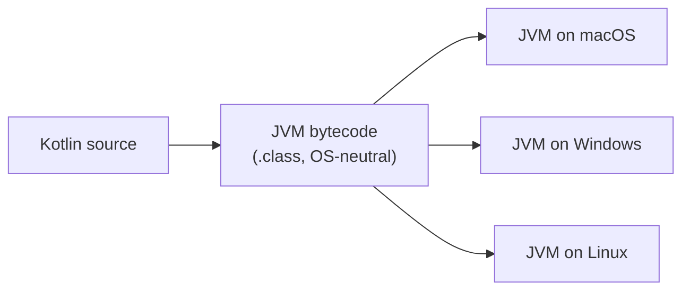
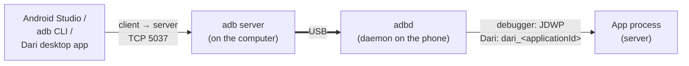
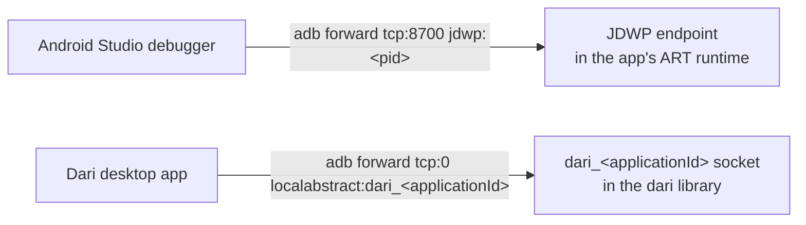
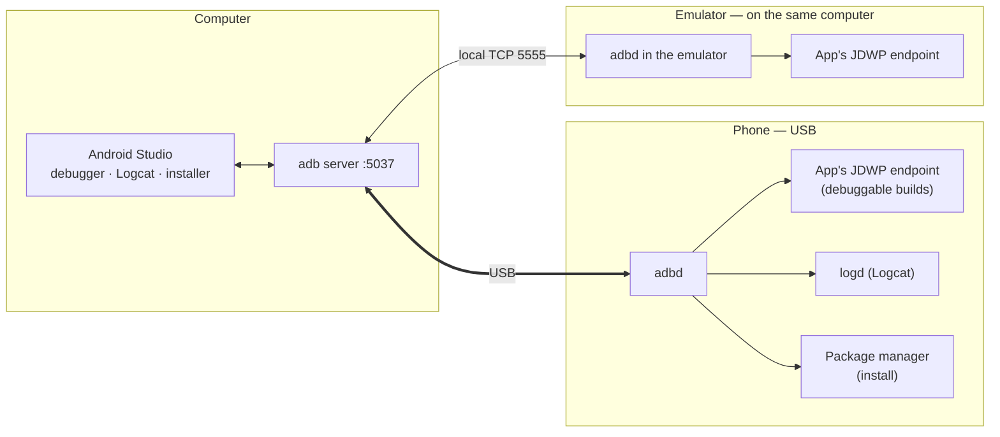
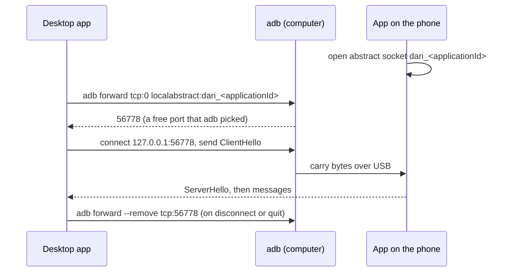
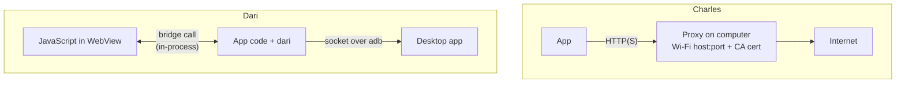
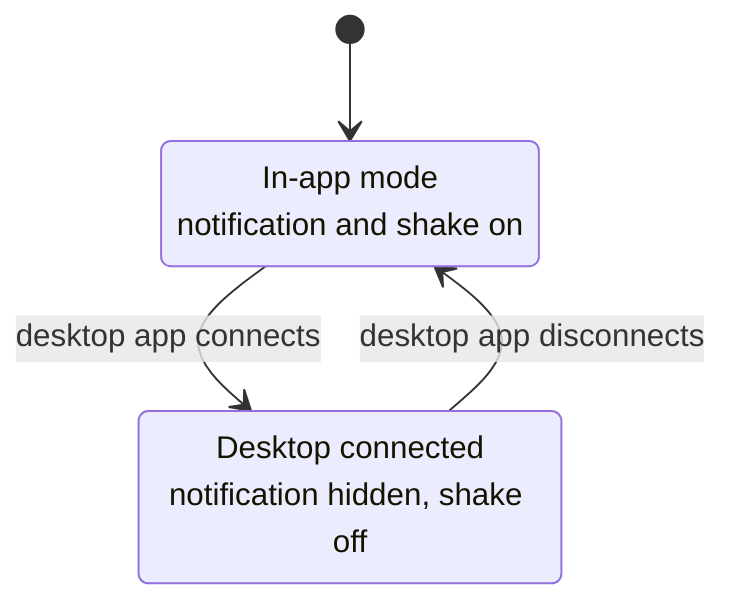
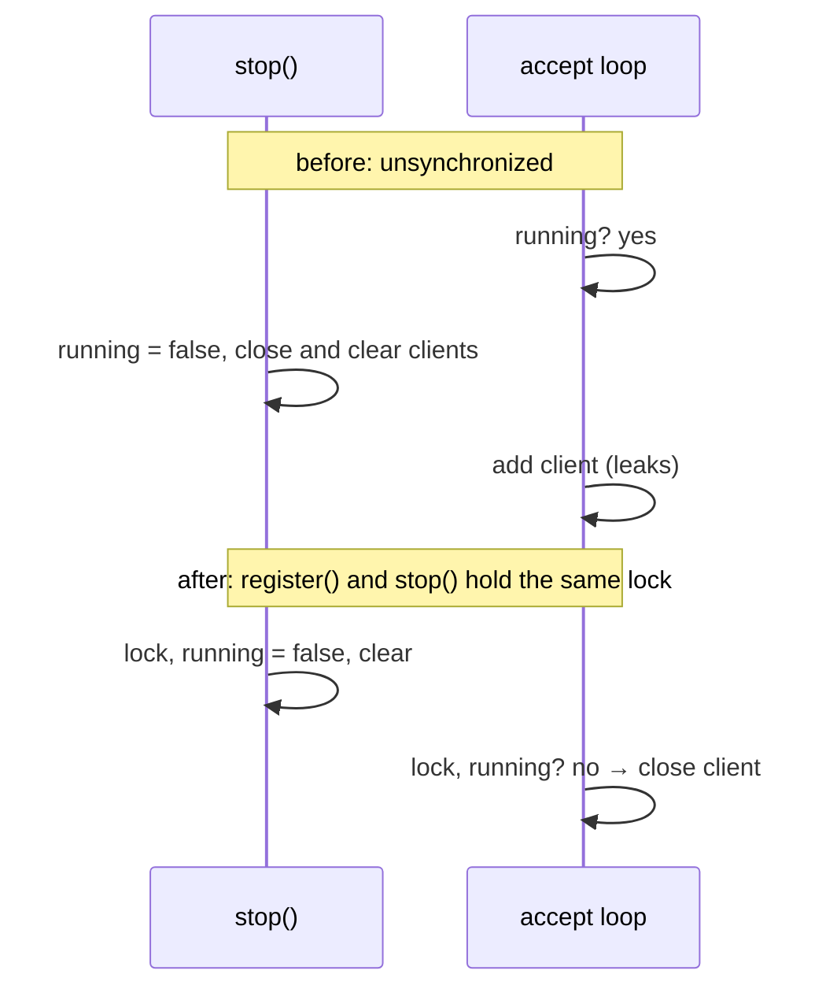

# Desktop Inspector FAQ

Questions that came up while building the desktop inspector (#99), with the reasoning behind each
answer. For the design itself, see [desktop-inspector-design.md](desktop-inspector-design.md).

## 1. Why Compose Multiplatform and not Swift?

The desktop app has to run on macOS, Windows and Linux. SwiftUI only runs on macOS, so Windows and
Linux would each need a second UI. Compose Multiplatform runs on the JVM, so one Kotlin codebase
covers all three, and it reuses Dari's Kotlin models directly.

The trade-offs are a larger download (about 67 MB, because a Java runtime is bundled), a slower first
launch, and a less native feel. The UI borrows macOS conventions to narrow the gap: menu bar, ⌘
shortcuts, Settings… in the app menu, a transparent title bar, and system dark mode. For a debugging
tool that was an acceptable price.

### Why does the JVM make this portable?

Kotlin compiles to JVM bytecode, an intermediate form that names no OS or CPU. Each OS has its own
JVM that runs the same bytecode, and the JVM wraps OS services (files, sockets, processes) in one
API. That is why `ProcessBuilder("adb")` and `Socket("127.0.0.1", port)` work unchanged everywhere.

It differs from Docker:

| | JVM | Docker |
| --- | --- | --- |
| What moves between machines | The program (bytecode) | The whole environment (app plus userland) |
| How it runs elsewhere | A per-OS JVM interprets and JIT-compiles it | Shares the host kernel; Linux containers on macOS or Windows run inside a Linux VM |

Speed is mostly fine: the JIT compiles hot code to machine code while the app runs.

### Then why is there a build per OS?

Two parts are native:

- **Rendering.** Compose draws through Skia (Skiko), a native library with a binary per OS and CPU.
- **The bundled runtime.** Each installer ships a JRE for its own OS, so users don't install Java.

So the code is written once and packaged per OS: `.dmg` on macOS, `.msi` on Windows, `.deb` on
Linux.

## 2. When a device is connected, who is the server?

There are three hops, and each one has its own server:

1. **Tools to adb server.** The first `adb` command starts an adb server on the computer, listening on
   port 5037. Android Studio, the `adb` CLI and the Dari desktop app are all its clients.
2. **adb server to the phone.** With USB debugging on, `adbd` runs on the phone and accepts the
   computer's connection. The "Allow USB debugging?" prompt approves this link.
3. **Into the app.** The app process is the server:
   - Android Studio's debugger connects to the JDWP port that every debuggable app opens.
   - Dari's desktop app connects to the `dari_<applicationId>` socket that the `dari` library opens.

### What is JDWP?

JDWP (Java Debug Wire Protocol) is the protocol a debugger uses to talk to a running VM. Through it
Android Studio sets breakpoints, pauses and steps threads, and reads variables. On Android, the
runtime (ART) of every debuggable app exposes a JDWP endpoint. `adb jdwp` lists the processes that
have one, and Android Studio reaches one with a tunnel like `adb forward tcp:8700 jdwp:<pid>`. Release
builds aren't debuggable, so they have no JDWP endpoint, the same way they have no Dari socket.

Dari therefore works the same way as the Android Studio debugger: the app listens, and the computer
reaches it through an adb tunnel. That is also why the app sees its peer as uid 2000 (adb shell): the
process that actually opens the connection on the phone is `adbd`.

### How the Dari desktop app works, end to end

```mermaid
flowchart LR
    subgraph phone["Phone or emulator — debuggable app"]
        direction TB
        js["JavaScript in WebView"] <-->|"bridge call"| bridge["App bridge code"]
        bridge -->|"onWebToAppRequest / ..."| icpt["DariInterceptor"]
        icpt --> repo["MessageRepository<br/>(memory + Room)"]
        repo -->|"added / updated / cleared"| sess["InspectorSession<br/>masking + redactor"]
        sess --> srv["DariInspectorServer<br/>@dari_&lt;applicationId&gt;<br/>adb (uid 2000) only"]
        adbd["adbd"]
    end
    subgraph computer["Computer"]
        direction TB
        adbsrv["adb server :5037"]
        port["127.0.0.1:&lt;free port&gt;<br/>adb forward"]
        app["Dari desktop app<br/>list · detail · JSON tree"]
    end
    srv <-->|"local socket"| adbd
    adbd <==>|"USB (device)<br/>or TCP (emulator)"| adbsrv
    adbsrv --- port
    port <-->|"TCP: hello, then list / detail / observe"| app
```

1. A bridge call goes through `DariInterceptor`, and `MessageRepository` stores it and emits an event.
2. `InspectorSession` masks the message and writes it to the `dari_<applicationId>` socket.
3. adb carries the bytes to the forwarded port on the computer.
4. The desktop app shows the message. It first subscribes to `observe`, then asks for the backlog with
   `list`, then fetches bodies with `detail` when a message is selected.

### How Android Studio talks to a phone or emulator

A real phone is reached over USB. An emulator runs `adbd` inside it and registers with the adb server
over local TCP (port 5555 for the first emulator), so to every adb client it looks like a USB device.
That is why the Dari desktop app needs no special case for emulators.

### Side by side

| | Android Studio | Dari desktop app |
| --- | --- | --- |
| Client on the computer | Android Studio (and the `adb` CLI) | Dari desktop app |
| Path to the device | adb server → USB or local TCP → `adbd` | The same adb server and `adbd` |
| Endpoint inside the app | JDWP, opened by ART in debuggable builds | `dari_<applicationId>`, opened by the `dari` library in debuggable builds |
| Tunnel | `adb forward tcp:<port> jdwp:<pid>` | `adb forward tcp:0 localabstract:dari_<applicationId>` |
| What flows | Breakpoints, stepping and variables; Logcat lines; APK installs | Bridge messages: summaries, bodies and live events, masked before they leave |
| Who may connect | Anyone with adb access to the device | Only adb (uid 2000) or root, checked by the app |
| Release builds | Not debuggable, so no JDWP | `dari-noop`, so no socket and no capture code |
| Setup on the device | USB debugging | USB debugging; the `dari` debug dependency in the app |

## 3. What is `adb forward`, and why are there no ports to set?

`adb forward` is a USB tunnel. It opens a port on the computer and pipes it to a socket inside the
phone. Dari's app socket has a name but no port, so a tunnel is the only way in.

`tcp:0` tells adb to pick a free port, so nothing has to match. The desktop app removes its tunnels
when it disconnects, when it quits, and on its next start (in case it was killed). `adb forward --list`
shows any open tunnels. Emulators are adb devices too, so they work the same.

## 4. Charles needs no library. Why does Dari?

Charles is an HTTP proxy. It sits on the network path and intercepts traffic before it leaves the
device, so the app's code doesn't need to change. WebView bridge calls never touch the network: they
are in-process calls between JavaScript and the app (`@JavascriptInterface`, `evaluateJavascript`).
Only code inside the app can see them.

| | Charles | Dari |
| --- | --- | --- |
| Intercepts | Network traffic | In-process bridge calls |
| Device setup | Wi-Fi proxy host and port, user CA certificate | None |
| App setup | `network_security_config` trusting user CAs (for HTTPS) | The `dari` debug dependency |
| Same Wi-Fi needed | Yes | No; USB or any adb connection |
| Ports to match | The proxy port on device and computer | None |

## 5. Why not just read logcat?

The desktop app could tail `adb logcat` with no library, but:

- Bridge calls aren't in logcat unless the app logs each one, so app code changes anyway.
- logcat truncates lines at about 4 KB and drops chatty output, so large bodies arrive cut off.
- Pairing requests with responses, status and duration would have to be re-parsed from text.
- `Log` calls ship in release builds, unmasked, and any adb client can read them. `dari-noop` ships
  no capture code, and the desktop channel masks secrets before data leaves the device.

## 6. Why was the library split into two artifacts and then merged back?

The first goal was that in-app and desktop never both raise notifications. One way was a separate
`dari-desktop` artifact, so choosing the dependency chose the surface. The catch: existing users would
have had to swap dependencies just to try the desktop app.

The same goal is met inside one artifact. While a desktop is connected, the in-app notification and
shake-to-open pause, and they resume on disconnect.

So upgrading `dari` is all it takes. `Dari.setDesktopInspectorEnabled(false)` keeps the socket closed
for anyone who doesn't want it. Release builds still use `dari-noop`.

## 7. What is ad-hoc signing, and why use it?

macOS has three levels:

| Level | What it proves | User experience | Cost |
| --- | --- | --- | --- |
| Unsigned | Nothing | Won't run on Apple Silicon | — |
| Ad-hoc (`codesign --sign -`) | The files weren't altered | First launch is blocked; System Settings → Privacy & Security → **Open Anyway**, once | Free |
| Developer ID plus notarization | Who published it, and Apple scanned it | Opens normally | Apple Developer Program (yearly fee), signing secrets in CI |

Dari ships ad-hoc signed DMGs, as Necto does. The audience is developers, and allowing an app once is
a small ask. Moving to Developer ID later only changes the signing step and the CI secrets. The
Windows MSI is unsigned, so SmartScreen shows a similar one-time **More info → Run anyway**.

## 8. Which "server" did the stop-time race condition refer to?

The small socket server inside the app (`DariInspectorServer`, part of the `dari` library), not
anything on the computer. If a desktop connected at the exact moment the server was stopping (for
example via `setDesktopInspectorEnabled(false)`), that one connection could survive the shutdown.
Its connected-client count could also stay above zero, which kept the in-app notification paused.
Registering a client and stopping now share one lock, and registration re-checks that the server is
still running.

## 9. How far does CI check Windows and Linux?

The `Desktop App` workflow runs on macOS, Windows and Ubuntu. On each it runs the unit tests, then
launches the packaged app and checks that it stays up for 15 seconds without errors. On Linux it runs
under a virtual display (xvfb) with software rendering.

That proves the app starts: the bundled runtime, Compose rendering and native libraries all load. It
doesn't prove that the layout looks right, that menus and buttons work, or that a real phone
connects, because the runners have no phone and nobody looks at the screen.

- **macOS**: tested by hand; shipped.
- **Windows**: ships as a preview until the hands-on checklist in #104 passes.
- **Linux**: builds and launches in CI. A cloud attempt couldn't open a display, so it isn't
  released until someone tests it on a desktop Linux machine.

## 10. Why did CodeRabbit keep hitting its rate limit?

The free OSS plan allows a limited number of reviews per time window. Every push to a PR triggered
another review, so several pushes in a row used up the window. `.coderabbit.yaml` now reviews a PR
once when it opens, and later pushes don't trigger another review. To ask for one, comment
`@coderabbitai review` on the PR.
