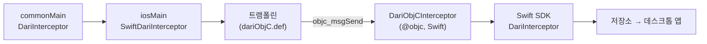

# Swift SDK로 가는 KMP 브리지 (#13)

상태: PoC ([#304](https://github.com/easyhooon/dari/pull/304)) · 배포 전 · English: [kmp-swift-bridge.md](kmp-swift-bridge.md)

`dari-kmp`가 iOS에서 Kotlin `commonMain` 코드의 브리지 메시지를 Swift SDK로 기록하는 방법을 정리한 문서입니다.
왜 이렇게 만들었는지, Kotlin의 Swift export가 이 구조를 어떻게 바꿀 수 있는지도 함께 다룹니다.
Kotlin 관련 사실은 공식 문서에서 가져왔습니다. 확인한 날짜는 2026-11-13이고, 기준은 Kotlin 2.4.21 문서와 2.5.0-RC까지의 릴리스 노트입니다.
Dari 빌드는 Kotlin 2.2.10을 씁니다.

## 용어

| 용어 | 뜻 | Android 비유 |
| --- | --- | --- |
| Kotlin/Native | Kotlin을 iOS용 기계어로 컴파일합니다. C·Objective-C와는 대화하지만 순수 Swift와는 못 합니다 | — |
| cinterop / `.def` 파일 | C/ObjC 선언을 Kotlin API로 바꿉니다. 무엇을 가져올지는 `.def` 파일이 정합니다 | JNI 헤더와 `external` 선언 |
| `@objc` | Swift 선언을 Objective-C 런타임에 노출합니다 | `@JvmName`, `@JvmStatic`: 다른 언어에서 보이게 하는 표시 |
| `objc_msgSend` | 모든 ObjC 메서드 호출이 컴파일되는 런타임 함수. 메서드를 이름(selector)으로 찾습니다 | 리플렉션 `Method.invoke`와 비슷하지만, 이게 일반 호출 경로이고 빠릅니다 |
| 트램폴린(중계 함수) | 호출을 다른 곳으로 넘기기만 하는 작은 함수 | C++ 라이브러리로 넘기기만 하는 얇은 JNI C 함수 |
| Dead strip | 아무도 참조하지 않는 코드를 링커가 빼는 것 | R8 shrinking |
| Swift export | Kotlin을 ObjC 헤더 대신 Swift API로 내보내는 Kotlin 2.x 기능 | — |
| Reverse import | Kotlin이 인터페이스를 선언하고, Swift가 구현해서 그 인스턴스를 Kotlin에 넘기는 방식 | `commonMain` 인터페이스의 Android 구현을 주입하는 것 |

## 1. 문제

`DariInterceptor`는 `dari-core`의 `commonMain`에 있습니다. 그래서 KMP 앱은 브리지 코드를 공유 코드에 둘 수 있습니다.
Android에서는 `dari-runtime`이 이 인터페이스를 구현합니다.
iOS에는 구현이 없습니다. 기록, 저장, 데스크톱 연결이 모두 Swift SDK에 있는데 Kotlin/Native는 Swift SDK를 호출하지 못합니다.

공식 문서도 분명히 적고 있습니다. Kotlin/Native는 순수 Swift 라이브러리를 직접 import하지 못합니다
([library import](https://kotlinlang.org/docs/native-lib-import-stability.html)).
Kotlin이 Swift API를 쓰려면 그 API가 `@objc`로 Objective-C에 노출돼 있어야 합니다
([ObjC interop](https://kotlinlang.org/docs/native-objc-interop.html)).
Swift SDK의 API에는 `@objc`가 없습니다.

무거운 부분은 Swift SDK가 이미 다 하고 있습니다. 루프백 리스너, wire 프로토콜, 저장소와 디스크 저장, 마스킹, 인앱 인스펙터가 그렇습니다.
이걸 Kotlin/Native로 다시 만들면 몇 주가 걸립니다. `dari-runtime`은 Room과 Android API에 묶여 있어서 재사용할 수도 없습니다.
그래서 남은 일은 두 언어를 잇는 것뿐입니다.

## 2. PoC 동작 방식



### Swift: Objective-C 진입점

`dari-ios/Sources/Dari/DariObjC.swift`가 기존 API 위에 `NSObject` 하위 클래스 두 개를 추가합니다. 기존 Swift API는 그대로입니다.

- `DariObjC`: `start()`, `stop()`, `interceptor(tag:)`
- `DariObjCInterceptor`: 요청/응답 콜백 4개와 `onPageUrlChanged`

중요한 점이 두 가지 있습니다.

- **런타임 이름 고정.** `@objc(DariObjC)`로 클래스를 `DariObjC`라는 이름으로 등록합니다. 이게 없으면 Swift는 맹글링된 이름으로 등록하고, `NSClassFromString("DariObjC")`가 nil을 반환합니다.
- **`Bool?` 대신 `NSNumber?`.** Objective-C에는 옵셔널 `BOOL`이 없습니다. `fireAndForget`은 세 가지 상태를 가집니다(nil은 설정값을 따르라는 뜻).

### Kotlin: 라이브러리 없는 cinterop 파일

`dari-kmp/src/nativeInterop/cinterop/dariObjC.def`에는 `headers`도 `linkerOpts`도 없습니다.
공식 문서에 따르면 `---` 줄 아래는 헤더 파일의 일부로 취급됩니다
([definition file](https://kotlinlang.org/docs/native-definition-file.html)).
여기에 두 가지를 선언합니다.

1. selector를 나열한 ObjC `@protocol`. 컴파일러가 인자 타입을 알게 하려는 용도입니다.
2. `static inline` 트램폴린. 하나는 `NSClassFromString(@"DariObjC")`를 호출하고, 클래스가 없으면 nil을 반환합니다. 나머지는 각각 메시지를 하나씩 보냅니다.

```objc
static inline void dari_kmp_onPageUrlChanged(id target, NSString *url) {
    [(id<DariKmpObjCInterceptor>)target onPageUrlChanged:url];
}
```

Kotlin은 이 함수들을 일반 C 함수처럼 호출하고, 그 경계에서 Kotlin/Native가 `String`을 `NSString`으로 바꿔 줍니다.
메시지 전송은 `objc_msgSend`로 컴파일되기 때문에, 링크 시점에 Dari 심볼을 참조하는 곳이 없습니다.

### Kotlin: 모듈 구성

- `commonMain`: `DariKmp.createInterceptor(tag): DariInterceptor?`. Android의 `Dari.createInterceptor`처럼 nullable입니다.
- `androidMain`: `dari-runtime`의 `DefaultDariInterceptor`를 반환합니다.
- `iosMain`: 각 호출을 트램폴린으로 넘기는 `SwiftDariInterceptor`를 반환합니다. `DariObjC`를 못 찾으면 `NSLog`로 로그를 남기고 null을 반환합니다.

### Kotlin에서 `objc_msgSend`를 직접 부르면 안 되나?

`dlsym`으로 `objc_msgSend`를 찾아 Kotlin 함수 포인터로 캐스팅하는 쪽이 더 간단해 보입니다.
하지만 Kotlin `String`은 cinterop이 선언한 ObjC 파라미터를 지날 때만 `NSString`이 됩니다.
Kotlin 문자열에서 꺼낸 raw 포인터는 `NSString`이 아니라 Kotlin 객체를 가리키기 때문에 호출하면 크래시가 납니다.
트램폴린을 두면 이 변환을 Kotlin/Native가 대신 해 줍니다.

## 3. 방식 비교

| | (a) SDK에 링크하는 cinterop | (b) 런타임 조회 (PoC) | (c) Reverse import |
| --- | --- | --- | --- |
| Kotlin이 Swift에 닿는 방법 | SDK의 ObjC 헤더를 import하고 링크 | `NSClassFromString`과 트램폴린 | 앱이 Kotlin 인터페이스를 구현한 Swift 객체를 넘김 |
| SDK에 `@objc` 필요 | 필요 | 필요 | 불필요 |
| 타입 안전성 | 완전 | selector는 우리 `.def`하고만 대조됨 | 완전 |
| 빌드 설정 | 어려움: SPM 프레임워크를 klib과 앱 빌드에 링크 | `.def` 외에는 없음 | 없음 |
| 앱마다 쓸 코드 | 없음 | 없음 | Swift 어댑터 약 40줄 |
| SDK가 없을 때 | 링크 에러 또는 실행 시 크래시 | null과 로그 한 줄 | 앱이 구현을 넘기지 않음 |
| 공식 문서상 위치 | 문서화된 우회책("manual Objective-C bridging") | 같은 우회책, 링크만 뺌 | "대부분의 경우" 권장 |

공식 문서는 (c)를 권장합니다. 대부분의 경우 reverse import 방식을 쓰라고 적혀 있습니다
([library import](https://kotlinlang.org/docs/native-lib-import-stability.html)).
(c)는 지금의 ObjC export로도 됩니다. Kotlin 클래스와 인터페이스는 Swift/ObjC 클래스와 프로토콜이 상속할 수 있기 때문입니다
([ObjC interop](https://kotlinlang.org/docs/native-objc-interop.html)).

**Dari PoC가 (b)를 쓴 이유.**
(c)에서 Swift가 구현하는 프로토콜은 앱 자신의 Kotlin 프레임워크 안에서, 그 프레임워크 이름을 붙여 생성됩니다.
예를 들어 프레임워크 이름이 `DariKmpSample`이면 `DKSDariInterceptor`가 됩니다.
Swift SDK는 그 프레임워크가 생기기 전에 따로 컴파일되는 패키지라서 이 어댑터를 미리 넣어 둘 수 없습니다. 결국 앱마다 어댑터를 직접 쓰고 관리해야 합니다.
(b)는 그 코드를 Dari 쪽에 둡니다.
(a)는 타입 안전하지만, SPM으로 배포되는 프레임워크를 Kotlin 빌드에 링크하는 일이 어렵습니다. 게다가 Kotlin의 SwiftPM import는 아직 Alpha입니다(5절 참고).

(c)는 `dari-kmp`에 의존하고 싶지 않은 앱을 위한 레시피로 문서화할 만한 대안입니다.

## 4. 발견한 함정

### Dead strip

(b)에서는 링크 시점에 `DariObjC`를 참조하는 곳이 없습니다. 그래서 링커가 이 클래스를 뺄 수 있습니다. R8이 `Class.forName`으로만 쓰는 클래스를 지우는 것과 같은 상황입니다.
PoC에서는 `-dead_strip`로 링크하는 Staging 빌드에서도 `DariObjC`가 남았습니다.
Xcode가 SPM 타깃 하나를 미리 합친 오브젝트 파일(`Dari.o`)로 만들어 링커에 직접 넘기기 때문입니다.
커맨드라인에 직접 적힌 오브젝트 파일은 항상 로드되고, ObjC 클래스 메타데이터도 유지됩니다.

다른 연동 방식에서는 결과가 다를 수 있습니다.
SDK가 정적 라이브러리(`.a`)로 들어오면, 링커는 심볼이 참조된 오브젝트 파일만 가져옵니다.
그런 경우에는 `Dari.start()`가 `DariObjC`를 참조하게 하거나, 앱에서 `-ObjC`로 링크해야 합니다. 이 경우는 테스트하지 않았습니다.

### Swift에서의 이름 충돌

`dari-core`를 export하는 KMP 프레임워크는 Kotlin 인터페이스를 Swift에 `DariInterceptor`라는 이름으로 노출합니다. Swift SDK에도 같은 이름의 클래스가 있습니다.
두 모듈을 함께 import한 Swift 파일에서 확인한 결과는 다음과 같습니다.

| 참조 방법 | 결과 |
| --- | --- |
| `DariInterceptor` | 에러: 타입 조회가 모호함 |
| `Dari.DariInterceptor` | 에러: 클래스 `Dari.Dari`의 멤버 타입이 아님. `Dari` 클래스가 모듈 이름을 가림 |
| `import class Dari.DariInterceptor` 후 `DariInterceptor` | 컴파일됨 |
| `DariKmpSample.DariInterceptor` | 컴파일됨 |
| 타입 추론 (`let i = Dari.shared.interceptor()`) | 컴파일됨 |

한쪽 모듈만 import한 파일은 영향이 없습니다. 문서에 한 줄 적는 것으로 충분합니다.
부족하다면 Kotlin 쪽에서 `@ObjCName(swiftName = ...)`로 Swift 이름을 바꿀 수 있습니다(`@ExperimentalObjCName` opt-in 필요).
`@HiddenFromObjC`로 선언을 숨길 수도 있습니다([ObjC interop](https://kotlinlang.org/docs/native-objc-interop.html)).

### 작은 함정들

- cinterop 선언을 쓰려면 `@OptIn(ExperimentalForeignApi::class)`가 필요합니다. ObjC 라이브러리 import는 Kotlin 2.3.0부터 Beta입니다([what's new 2.3](https://kotlinlang.org/docs/whatsnew23.html)).
- `.def`는 `package = com.easyhooon.dari.kmp.objc`를 지정합니다. 공식 문서는 배포하는 라이브러리라면 interop에 별도 패키지를 쓰라고 권합니다. 그래야 "symbol multiply defined" 같은 충돌을 피할 수 있습니다([library import](https://kotlinlang.org/docs/native-lib-import-stability.html)).
- Gradle이 cinterop commonization이 꺼져 있다고 경고합니다. PoC는 이 cinterop을 `iosMain`에서만 씁니다. 공식 문서에서 현재 상태를 확인하지 못했으니 배포 전에 확인해야 합니다.
- `export(project(":dari-core"))`는 `dari-core`의 API 전체를 프레임워크에 넣고, 그 부분의 dead code elimination을 끕니다. export는 기본적으로 전이되지 않습니다([native binaries](https://kotlinlang.org/docs/multiplatform/multiplatform-build-native-binaries.html)).

## 5. 전망: Swift export와 SwiftPM import

### Swift export 현황

| Kotlin | Swift export | 출처 |
| --- | --- | --- |
| 2.1.0 | 기본 지원. Gradle 속성으로 켜야 함 | [what's new 2.1](https://kotlinlang.org/docs/whatsnew21.html) |
| 2.2.20 | Experimental, 기본으로 켜짐 | [what's new 2.2.20](https://kotlinlang.org/docs/whatsnew2220.html) |
| 2.4.0 | Alpha. `suspend` → `async`, `Flow` → `AsyncSequence` | [what's new 2.4](https://kotlinlang.org/docs/whatsnew24.html) |
| 2.4.20 | 언어 간 상속 (Swift가 Kotlin 인터페이스 구현) | [what's new 2.4.20](https://kotlinlang.org/docs/whatsnew2420.html) |
| 2.5.0-RC | Beta, 새 Gradle DSL | [what's new in the EAP](https://kotlinlang.org/docs/whatsnew-eap.html) |

[로드맵](https://kotlinlang.org/docs/roadmap.html)에는 "Swift Export: from Alpha to Beta" 항목이 있습니다.
[KMP 로드맵 글](https://blog.jetbrains.com/kotlin/2025/08/kmp-roadmap-aug-2025/)은 2026년 안정화를 목표로 합니다.
제네릭은 아직 대체로 지원되지 않습니다([Swift export](https://kotlinlang.org/docs/native-swift-export.html)).

### Swift export는 한 방향이다

Swift export가 바꾸는 건 **Swift에서 Kotlin이 어떻게 보이느냐**입니다. Kotlin이 Swift를 호출하게 해 주지는 않습니다.
공식 문서와 로드맵 어디에도 순수 Swift를 Kotlin으로 import하는 계획은 없습니다.
따라서 Swift export가 나와도 (b)나 (c)는 계속 필요합니다.

### 앱이 Swift export를 쓰면 바뀌는 것

- **이름.** Kotlin 모듈은 Swift 모듈이 되고, 패키지는 이름 충돌을 피하려고 중첩 네임스페이스가 됩니다([Swift export](https://kotlinlang.org/docs/native-swift-export.html)).
  프레임워크 접두어도 사라집니다. `DariInterceptor` 충돌은 모듈 한정으로 풀 문제가 됩니다.
  다만 `Dari` 클래스는 여전히 `Dari` 모듈 이름을 가리기 때문에, `import class Dari.DariInterceptor`가 계속 우회책입니다.
- **(c)가 더 편해집니다.** 언어 간 상속은 reverse import 패턴과 순수 Swift 라이브러리 사용을 위해 만든 기능입니다.
  어댑터가 Swift 프로토콜을 구현하는 평범한 Swift 코드가 됩니다. 하지만 여전히 앱 모듈 안에서 생성되므로 Swift SDK가 미리 넣어 둘 수는 없습니다.
- **(b)는 영향이 없습니다.** (b)는 앱의 export를 아예 쓰지 않고, 트램폴린이 ObjC 런타임과 직접 대화합니다.
  앱이 ObjC로 export하든 Swift로 export하든 그대로 동작합니다. 둘 중 미래 변화에 더 안전한 쪽입니다.
- **도입 비용.** 언어 간 상속은 Kotlin 2.4.20 이상이 필요합니다(Dari는 2.2.10).
  Swift export는 direct integration을 쓰는 프로젝트에서만 동작하고, 2.5.0에서 DSL이 또 바뀝니다.

### SwiftPM import: 방식 (a)로 가는 길

Kotlin 2.4.0에 Swift package import가 추가됐습니다([what's new 2.4](https://kotlinlang.org/docs/whatsnew24.html)).
[SwiftPM import 문서](https://kotlinlang.org/docs/multiplatform/multiplatform-spm-import.html)는 이 기능을 Alpha로 표시합니다.
이 기능은 Clang 모듈을 import하기 때문에 Objective-C API만 봅니다. `@objc`가 붙은 Swift 코드도 여기에 포함됩니다.
Dari에 적용하면 Dari 패키지에서 `DariObjC`를 import해 손으로 쓴 `.def`를 대체할 수 있습니다.
타입 안전성이 생기는 대신 링크 시점 의존성도 생깁니다. Swift 전용 API에는 여전히 닿지 못합니다.

### 요약

| 미래 변화 | Dari에 미치는 영향 |
| --- | --- |
| Swift export 안정화 | 이름이 깔끔해지고 (c)가 편해짐. (b)는 그대로 |
| SwiftPM import 안정화 | (a)가 현실적이 됨: `.def` 없이 `DariObjC`를 타입 안전하게 호출 |
| Kotlin의 순수 Swift import (발표된 계획 없음) | `DariObjC`와 트램폴린 제거 가능. Kotlin이 SDK를 직접 호출 |

## 6. 출하 전 체크리스트

| 영역 | 할 일 | 예상 |
| --- | --- | --- |
| 배포 | Maven 좌표, ABI baseline, cinterop commonization 경고 정리 | 1일 |
| Android release 빌드 | `dari-kmp`가 noop 버전 없이 `dari-runtime`에 직접 의존함. `dari`의 초기화가 `DariRuntime.config`를 설정해 둔 것에 기대고 있음 | 1일 |
| `DariObjC` | start 옵션, `setEnvironment`, protobuf 추가. selector와 `.def`를 맞춰 두는 Swift 테스트 | 1일 |
| 샘플과 문서 | `xcodebuild` 덮어쓰기 대신 Xcode build phase 사용. documentation 사이트 사용자 페이지 | 1~2일 |
| 검증 | USB 실기기, 데스크톱 앱 화면, Android 실행, Kotlin에서 부른 WebKit 호출을 `autoCapture`가 잡는지 | 0.5일 |

## PoC에서 검증한 것

- iPhone 시뮬레이터(iOS 27.2, Xcode 27), Debug와 Staging 빌드에서 확인했습니다.
  `commonMain` 브리지가 보낸 호출 6개가 방향, 상태, displayName, 요청/응답 짝, 정리된 페이지 URL까지 정확히 기록됐습니다.
  영구 저장 파일, 인앱 인스펙터, 데스크톱 앱의 `IosAppFinder` 클라이언트 루프백 접속, 세 곳에서 확인했습니다.
- Swift SDK가 링크되지 않은 경우(`:dari-kmp:iosSimulatorArm64Test`), 팩토리는 로그를 남기고 null을 반환합니다.
- 위의 이름 충돌 결과는 빌드된 모듈에 `swiftc -typecheck`를 돌려서 얻었습니다.

## 참고 자료

공식 자료이고, 2026-11-13에 확인했습니다. kotlinlang.org는 Kotlin 2.4.21 문서를 제공하고 있었습니다.

| 자료 | 근거로 쓴 내용 |
| --- | --- |
| [C, Objective-C, and Swift library import](https://kotlinlang.org/docs/native-lib-import-stability.html) | 순수 Swift import 불가. manual ObjC bridging과 reverse import(권장). interop 전용 패키지 |
| [Interoperability with Swift/Objective-C](https://kotlinlang.org/docs/native-objc-interop.html) | `@objc` 필요. String ↔ NSString. Swift가 Kotlin 타입을 상속. `@ObjCName`, `@HiddenFromObjC`, `@ShouldRefineInSwift` |
| [Definition file](https://kotlinlang.org/docs/native-definition-file.html) | `.def` 속성. `---` 아래 코드는 `static`이어야 함 |
| [Interoperability with C](https://kotlinlang.org/docs/native-c-interop.html) | cinterop 기본, `@ExperimentalForeignApi` |
| [Swift export](https://kotlinlang.org/docs/native-swift-export.html) | 2.4.21 문서 기준 Alpha. 모듈/패키지 매핑. 언어 간 상속. 제네릭 제한. direct integration 전용 |
| [What's new in Kotlin 2.1.0](https://kotlinlang.org/docs/whatsnew21.html) | Swift export 기본 지원 |
| [What's new in Kotlin 2.2.20](https://kotlinlang.org/docs/whatsnew2220.html) | Swift export 기본 활성화 |
| [What's new in Kotlin 2.3.0](https://kotlinlang.org/docs/whatsnew23.html) | C·ObjC 라이브러리 import Beta |
| [What's new in Kotlin 2.4.0](https://kotlinlang.org/docs/whatsnew24.html) | Swift export Alpha. Swift package import |
| [What's new in Kotlin 2.4.20](https://kotlinlang.org/docs/whatsnew2420.html) | 언어 간 상속 |
| [What's new in the EAP (2.5.0-RC)](https://kotlinlang.org/docs/whatsnew-eap.html) | Swift export Beta, 새 DSL |
| [Kotlin roadmap](https://kotlinlang.org/docs/roadmap.html) | "Swift Export: from Alpha to Beta". SwiftPM import 항목. 순수 Swift import 항목 없음 |
| [KMP roadmap, Aug 2025](https://blog.jetbrains.com/kotlin/2025/08/kmp-roadmap-aug-2025/) | Swift export 2026년 안정화 목표 |
| [SwiftPM import](https://kotlinlang.org/docs/multiplatform/multiplatform-spm-import.html) | Alpha. Clang 모듈을 import하므로 ObjC/`@objc` API만 보임 |
| [Build native binaries](https://kotlinlang.org/docs/multiplatform/multiplatform-build-native-binaries.html) | `export()`, 비전이, dead code elimination 해제. `isStatic` |
