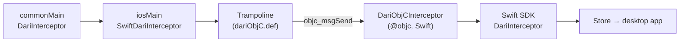

# KMP Bridge to the Swift SDK (#13)

Status: ready to ship with the next full release ([#304](https://github.com/easyhooon/dari/pull/304)) · User guide: [Kotlin Multiplatform](../documentation/content/docs/kmp.mdx) · Korean: [kmp-swift-bridge.ko.md](kmp-swift-bridge.ko.md)

This explains how `dari-kmp` lets Kotlin `commonMain` code record bridge messages on iOS through the Swift
SDK, why it is built this way, and how Kotlin's Swift export may change it. Kotlin facts cite the official
docs, checked on 2026-11-13 (docs for Kotlin 2.4.21, release notes up to 2.5.0-RC). Dari builds with Kotlin
2.2.10.

## Glossary

| Term | Meaning | Android analogy |
| --- | --- | --- |
| Kotlin/Native | Compiles Kotlin to machine code for iOS; talks to C and Objective-C, not to pure Swift | — |
| cinterop / `.def` file | Turns C/ObjC declarations into a Kotlin API; the `.def` file says what to import | JNI headers plus `external` declarations |
| `@objc` | Exposes a Swift declaration to the Objective-C runtime | `@JvmName`, `@JvmStatic`: make code visible to another language |
| `objc_msgSend` | The runtime function every ObjC method call compiles to; it looks the method up by name (selector) | Reflection's `Method.invoke`, but it is the normal call path and fast |
| Trampoline | A tiny function that only forwards a call somewhere else | A thin JNI C function that forwards to a C++ library |
| Dead stripping | The linker drops code nothing references | R8 shrinking |
| Swift export | Kotlin 2.x feature that exports Kotlin as a Swift API instead of an ObjC header | — |
| Reverse import | Kotlin declares an interface, Swift implements it and hands the instance to Kotlin | Injecting an Android implementation of a `commonMain` interface |

## 1. The problem

`DariInterceptor` lives in `dari-core`'s `commonMain`, so a KMP app can keep its bridge in shared code. On
Android, `dari-runtime` implements it. On iOS nothing does: the recording, storage and desktop connection
live in the Swift SDK, and Kotlin/Native can't call it.

The official docs are explicit about this: "Kotlin/Native does not support direct import of pure Swift
libraries" ([library import](https://kotlinlang.org/docs/native-lib-import-stability.html)). Kotlin can use a
Swift API only if it is exported to Objective-C with `@objc`
([ObjC interop](https://kotlinlang.org/docs/native-objc-interop.html)). The Swift SDK's API has no `@objc`.

The Swift SDK already does the heavy work: the loopback listener, the wire protocol, the store and its
persistence, masking, and the in-app inspector. Reimplementing that in Kotlin/Native would take weeks, and
`dari-runtime` can't be reused because it depends on Room and Android APIs. So the job is only to bridge
the two languages.

## 2. How the PoC works



### Swift: an Objective-C entry point

`dari-ios/Sources/Dari/DariObjC.swift` adds two `NSObject` subclasses over the existing API, which stays
unchanged:

- `DariObjC`: `start()`, `stop()`, `interceptor(tag:)`.
- `DariObjCInterceptor`: the four request/response callbacks and `onPageUrlChanged`.

Two details matter:

- **Fixed runtime names.** `@objc(DariObjC)` registers the class as `DariObjC`. Without it, Swift registers
  a mangled name and `NSClassFromString("DariObjC")` returns nil.
- **`Bool?` becomes `NSNumber?`.** Objective-C has no optional `BOOL`, and `fireAndForget` has three states
  (nil means "use the configuration").

### Kotlin: a cinterop file with no library

`dari-kmp/src/nativeInterop/cinterop/dariObjC.def` has no `headers` and no `linkerOpts`. After the `---`
line, which the docs say "is treated as part of the header file"
([definition file](https://kotlinlang.org/docs/native-definition-file.html)), it declares:

1. An ObjC `@protocol` listing the selectors, so the compiler knows the argument types.
2. `static inline` trampolines. `dari_kmp_status()` looks up both classes with `NSClassFromString` and checks
   every selector, so an SDK older than `dari-kmp` is caught before any message is sent. The others send one
   message each:

```objc
static inline void dari_kmp_onPageUrlChanged(id target, NSString *url) {
    [(id<DariKmpObjCInterceptor>)target onPageUrlChanged:url];
}
```

Kotlin calls these like any C function, and Kotlin/Native converts `String` to `NSString` at that boundary.
The message send compiles to `objc_msgSend`, so nothing refers to a Dari symbol at link time.

### Kotlin: the module

- `commonMain`: `DariKmp.createInterceptor(tag): DariInterceptor?`, nullable like Android's
  `Dari.createInterceptor`.
- `androidMain`: calls `Dari.createInterceptor`. It compiles against `dari-noop` only (`compileOnly`), so the
  app's `debugImplementation(dari)` / `releaseImplementation(dari-noop)` decides what runs. Without either, it
  catches the `NoClassDefFoundError` and returns null.
- `iosMain`: checks `dari_kmp_status()` once, then returns `SwiftDariInterceptor`, which forwards each call to a
  trampoline. When the SDK is missing or too old, it logs once with `NSLog` and returns null.

### Version skew

`dari-kmp` ships through Maven Central and `DariObjC` through the Swift package's git tags, so an app can mix
releases. A selector the SDK lacks would end in an unrecognized-selector crash, which is why every selector is
checked up front. `DariObjCTests` in `dari-ios` reads the `.def` and fails when a selector it lists is missing
from `DariObjC`.

### Why not call `objc_msgSend` from Kotlin directly?

Looking `objc_msgSend` up with `dlsym` and casting it to a Kotlin function pointer looks simpler, but a
Kotlin `String` only becomes an `NSString` when it crosses a cinterop-declared ObjC parameter. A raw pointer
taken from a Kotlin string points at a Kotlin object, not an `NSString`, and the call would crash. The
trampolines let Kotlin/Native do that conversion.

## 3. Options compared

| | (a) cinterop linked to the SDK | (b) Runtime lookup (PoC) | (c) Reverse import |
| --- | --- | --- | --- |
| How Kotlin reaches Swift | Imports the SDK's ObjC header and links it | `NSClassFromString` plus trampolines | The app passes a Swift object implementing a Kotlin interface |
| Needs `@objc` in the SDK | Yes | Yes | No |
| Type safety | Full | Selectors are checked only against our own `.def` | Full |
| Build setup | Hard: link an SPM framework into the klib and app build | None beyond the `.def` | None |
| Code in each app | None | None | About 40 lines of Swift adapter |
| When the SDK is missing | Link error, or crash at launch | Null plus a log line | The app doesn't pass an implementation |
| Official status | Documented workaround ("manual Objective-C bridging") | Same workaround, without linking | Recommended "in most cases" |

The official docs recommend (c): "In most cases, however, we recommend using the reverse import approach"
([library import](https://kotlinlang.org/docs/native-lib-import-stability.html)). It works today with the
classic ObjC export, because "Kotlin classes and interfaces can be subclassed by Swift/Objective-C classes
and protocols" ([ObjC interop](https://kotlinlang.org/docs/native-objc-interop.html)).

**Why the PoC uses (b) for Dari.** With (c), the protocol Swift implements is generated inside the app's own
Kotlin framework, under that framework's name (`DKSDariInterceptor` for a framework named `DariKmpSample`).
The Swift SDK is a separate package compiled before that framework exists, so it can't ship the adapter.
Every app would write and maintain it. (b) keeps that code in Dari. (a) gives type safety, but linking an
SPM-distributed framework into the Kotlin build is the hard part, and Kotlin's SwiftPM import is Alpha
(see section 5).

(c) remains a good fallback to document as a recipe, for apps that would rather not depend on `dari-kmp`.

## 4. Pitfalls found

### Dead stripping

With (b), nothing references `DariObjC` at link time, so the linker could drop it, like R8 dropping a class
used only through `Class.forName`. In the PoC it stays, even in the Staging build that links with
`-dead_strip`, because Xcode links each SPM target as one prelinked object file (`Dari.o`) passed to the
linker directly. Object files named on the command line are always loaded, and ObjC class metadata is kept.

Other integrations may differ. If the SDK came as a static library (`.a`), the linker would load only
the object files whose symbols are referenced. In that case, either `Dari.start()` should reference
`DariObjC`, or apps should link with `-ObjC`. This was not tested.

### Name clash in Swift

A KMP framework that exports `dari-core` exposes the Kotlin interface to Swift as `DariInterceptor`, and the
Swift SDK has a class with the same name. In a Swift file importing both modules:

| Reference | Result |
| --- | --- |
| `DariInterceptor` | Error: ambiguous for type lookup |
| `Dari.DariInterceptor` | Error: not a member type of class `Dari.Dari`; the class `Dari` hides the module name |
| `import class Dari.DariInterceptor`, then `DariInterceptor` | Compiles |
| `DariKmpSample.DariInterceptor` | Compiles |
| Inferred type, such as `let i = Dari.shared.interceptor()` | Compiles |

Files that import only one of the modules are unaffected. A docs note is enough. If it isn't, Kotlin can
rename the Swift side with `@ObjCName(swiftName = ...)` (needs the `@ExperimentalObjCName` opt-in), or hide a
declaration with `@HiddenFromObjC` ([ObjC interop](https://kotlinlang.org/docs/native-objc-interop.html)).

### Smaller ones

- cinterop declarations need `@OptIn(ExperimentalForeignApi::class)`. ObjC library import is Beta as of
  Kotlin 2.3.0 ([what's new 2.3](https://kotlinlang.org/docs/whatsnew23.html)).
- The `.def` sets `package = com.easyhooon.dari.kmp.objc`. The docs advise a custom package for interop in a
  published library, to avoid clashes such as "symbol multiply defined"
  ([library import](https://kotlinlang.org/docs/native-lib-import-stability.html)).
- `kotlin.mpp.enableCInteropCommonization=true` in `gradle.properties`. Without it, each iOS target compiles,
  but the shared `iosMain` metadata compile that publishing runs can't see the cinterop declarations.
- `export(project(":dari-core"))` puts all of `dari-core`'s API in the framework and "disables dead code
  elimination" for it. Export is non-transitive by default
  ([native binaries](https://kotlinlang.org/docs/multiplatform/multiplatform-build-native-binaries.html)).

## 5. Outlook: Swift export and SwiftPM import

### Where Swift export stands

| Kotlin | Swift export | Source |
| --- | --- | --- |
| 2.1.0 | Basic support, behind a Gradle property | [what's new 2.1](https://kotlinlang.org/docs/whatsnew21.html) |
| 2.2.20 | Experimental, on by default | [what's new 2.2.20](https://kotlinlang.org/docs/whatsnew2220.html) |
| 2.4.0 | Alpha; `suspend` → `async`, `Flow` → `AsyncSequence` | [what's new 2.4](https://kotlinlang.org/docs/whatsnew24.html) |
| 2.4.20 | Cross-language inheritance (Swift implements Kotlin interfaces) | [what's new 2.4.20](https://kotlinlang.org/docs/whatsnew2420.html) |
| 2.5.0-RC | Beta, with a new Gradle DSL | [what's new in the EAP](https://kotlinlang.org/docs/whatsnew-eap.html) |

The [roadmap](https://kotlinlang.org/docs/roadmap.html) lists "Swift Export: from Alpha to Beta", and the
[KMP roadmap post](https://blog.jetbrains.com/kotlin/2025/08/kmp-roadmap-aug-2025/) aims for a stable release
in 2026. Generics are still "generally not supported"
([Swift export](https://kotlinlang.org/docs/native-swift-export.html)).

### Swift export goes one way

Swift export changes how **Kotlin looks from Swift**. It does not let Kotlin call Swift. No official page or
roadmap item mentions importing pure Swift into Kotlin. So it doesn't remove the need for (b) or (c).

### What would change if the app used Swift export

- **Names.** Kotlin modules become Swift modules, and packages become nested namespaces "to avoid name
  collisions" ([Swift export](https://kotlinlang.org/docs/native-swift-export.html)). There's no framework
  prefix. The `DariInterceptor` clash becomes a module-qualification question; the class `Dari` still hides
  the module `Dari`, so `import class Dari.DariInterceptor` stays the workaround.
- **Option (c) gets nicer.** Cross-language inheritance is designed for "the reverse import pattern" and
  pure Swift libraries. The adapter becomes plain Swift implementing a Swift protocol. It is still generated
  inside the app's module, so the Swift SDK still can't ship it.
- **Option (b) is unaffected.** It doesn't use the app's export at all; the trampolines talk to the ObjC
  runtime. It keeps working whether the app exports through ObjC or Swift, and it is the more future-proof
  of the two.
- **The cost of adopting it.** Inheritance needs Kotlin 2.4.20 or newer (Dari is on 2.2.10). Swift export
  works "only in projects that use direct integration", and the DSL changes again in 2.5.0.

### SwiftPM import, the path to option (a)

Kotlin 2.4.0 added Swift package import ([what's new 2.4](https://kotlinlang.org/docs/whatsnew24.html)), and
the [SwiftPM import page](https://kotlinlang.org/docs/multiplatform/multiplatform-spm-import.html) marks it
Alpha. It imports Clang modules, so it sees only Objective-C APIs, including Swift code marked `@objc`. For
Dari, that means it could replace the hand-written `.def` by importing `DariObjC` from the Dari package. It
would bring type safety and a link-time dependency. It can't reach the Swift-only API.

### Summary

| Future change | Effect on Dari |
| --- | --- |
| Swift export becomes stable | Better names and a nicer (c); (b) unchanged |
| SwiftPM import becomes stable | (a) becomes practical: typed calls to `DariObjC`, no `.def` |
| Kotlin imports pure Swift (not announced) | `DariObjC` and the trampolines could go; Kotlin calls the SDK directly |

## 6. Shipping status

| Area | State |
| --- | --- |
| Publishing | Done: Maven coordinates, ABI baseline, cinterop commonization on (the shared `iosMain` metadata compile needs it). Checked with a publish to the local `compat` repo |
| Android release builds | Done: `compileOnly(dari-noop)`, host test with `dari-noop` |
| `DariObjC` | Done: the selector-sync test. Protobuf is out of scope on iOS; record it from Swift |
| Sample | `sample-kmp/run-on-simulator.sh`; `sample-ios` needs no Gradle |
| User docs | [Kotlin Multiplatform](../documentation/content/docs/kmp.mdx) (en/ko). The site deploys on merge to `main`, so merge with the release |
| Not verified | USB device, the desktop window itself, `autoCapture` with WebKit calls from Kotlin |

## Verified

- iPhone Simulator (iOS 27.2, Xcode 27), Debug and Staging. Six calls from a `commonMain` bridge were recorded
  with the right direction, status, display name, pairing and sanitized page URL. Checked in the persisted
  store, in the in-app inspector, and over loopback with the desktop app's `IosAppFinder` client.
- Without the Swift SDK linked (`:dari-kmp:iosSimulatorArm64Test`), the factory logs and returns null.
- Android host test: with `dari-noop` on the classpath, the factory returns null.
- `DariObjCTests`: selectors match the `.def`, and calls reach the Swift store.
- The name-clash results above come from `swiftc -typecheck` against the built modules.

## References

Official sources, checked on 2026-11-13. kotlinlang.org served docs for Kotlin 2.4.21.

| Source | Used for |
| --- | --- |
| [C, Objective-C, and Swift library import](https://kotlinlang.org/docs/native-lib-import-stability.html) | No pure Swift import; manual ObjC bridging vs reverse import (recommended); custom interop package |
| [Interoperability with Swift/Objective-C](https://kotlinlang.org/docs/native-objc-interop.html) | `@objc` required; String ↔ NSString; Swift subclassing Kotlin types; `@ObjCName`, `@HiddenFromObjC`, `@ShouldRefineInSwift` |
| [Definition file](https://kotlinlang.org/docs/native-definition-file.html) | `.def` properties; custom code after `---` must be `static` |
| [Interoperability with C](https://kotlinlang.org/docs/native-c-interop.html) | cinterop basics, `@ExperimentalForeignApi` |
| [Swift export](https://kotlinlang.org/docs/native-swift-export.html) | Alpha status on the 2.4.21 docs; module/package mapping; cross-language inheritance; generics limit; direct integration only |
| [What's new in Kotlin 2.1.0](https://kotlinlang.org/docs/whatsnew21.html) | Swift export basic support |
| [What's new in Kotlin 2.2.20](https://kotlinlang.org/docs/whatsnew2220.html) | Swift export on by default |
| [What's new in Kotlin 2.3.0](https://kotlinlang.org/docs/whatsnew23.html) | C and ObjC library import in Beta |
| [What's new in Kotlin 2.4.0](https://kotlinlang.org/docs/whatsnew24.html) | Swift export Alpha; Swift package import |
| [What's new in Kotlin 2.4.20](https://kotlinlang.org/docs/whatsnew2420.html) | Cross-language inheritance |
| [What's new in the EAP (2.5.0-RC)](https://kotlinlang.org/docs/whatsnew-eap.html) | Swift export Beta, new DSL |
| [Kotlin roadmap](https://kotlinlang.org/docs/roadmap.html) | "Swift Export: from Alpha to Beta"; SwiftPM import item; no pure Swift import item |
| [KMP roadmap, Aug 2025](https://blog.jetbrains.com/kotlin/2025/08/kmp-roadmap-aug-2025/) | Stable Swift export targeted for 2026 |
| [SwiftPM import](https://kotlinlang.org/docs/multiplatform/multiplatform-spm-import.html) | Alpha; imports Clang modules, so ObjC/`@objc` APIs only |
| [Build native binaries](https://kotlinlang.org/docs/multiplatform/multiplatform-build-native-binaries.html) | `export()`, non-transitive, disables dead code elimination; `isStatic` |
